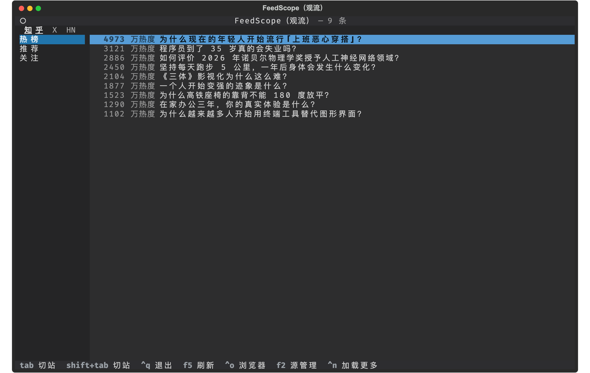
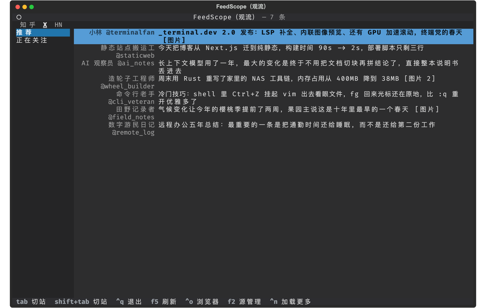
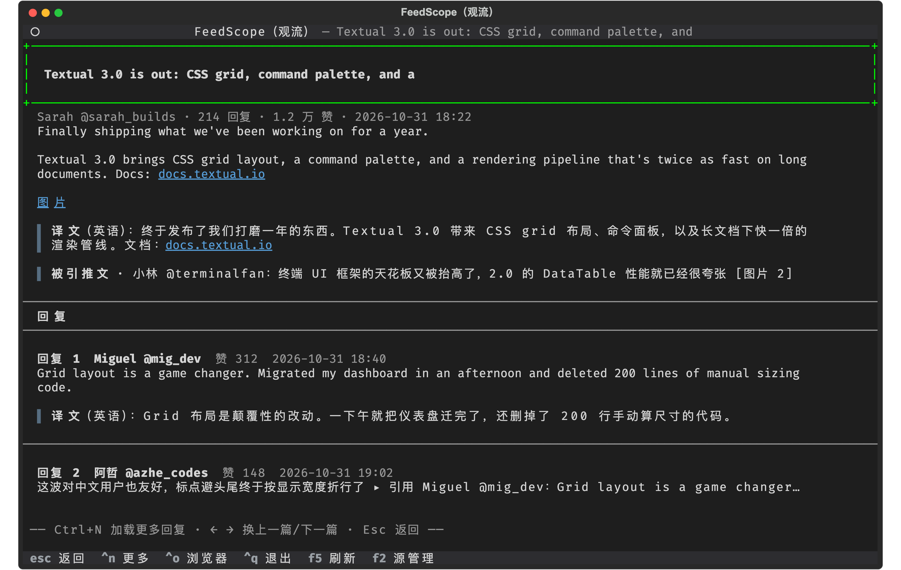
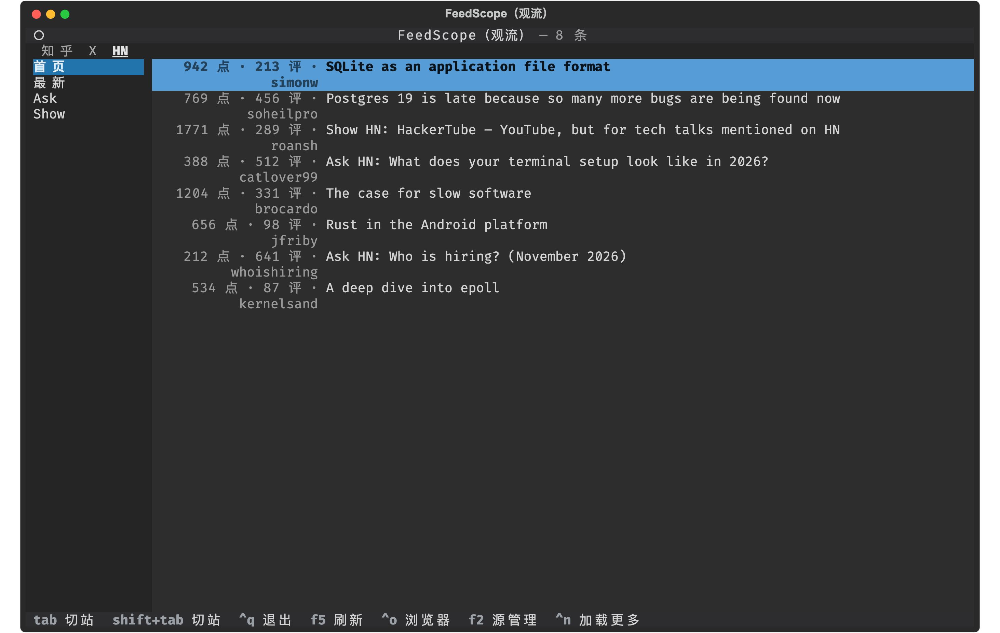
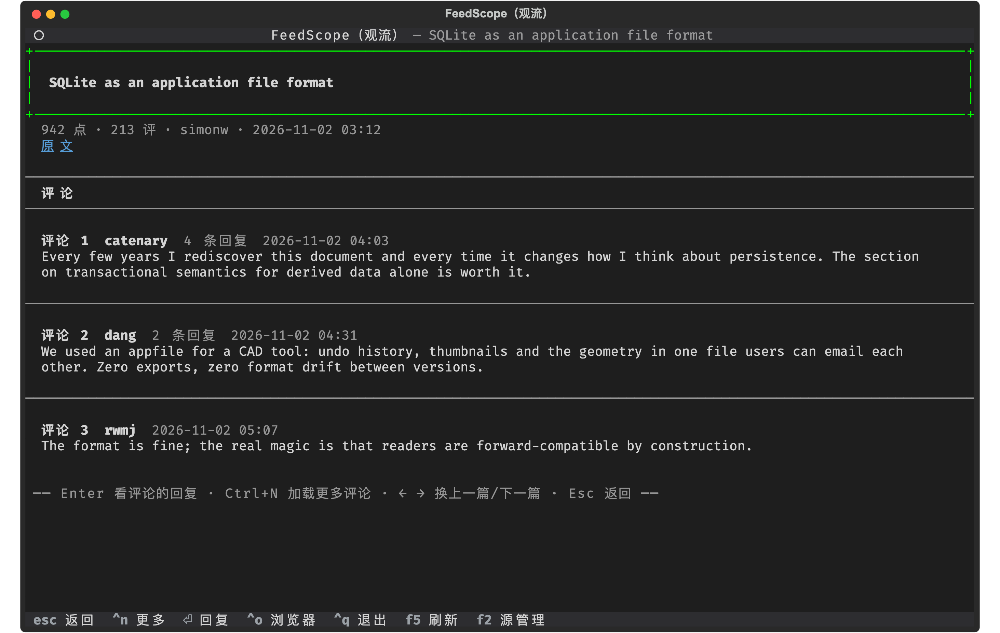
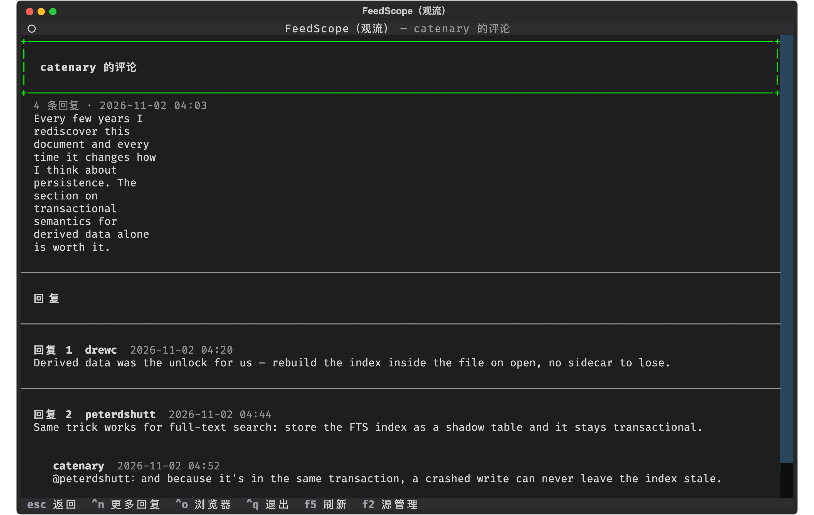

# FeedScope

[](LICENSE)
[](https://github.com/howardli/FeedScope/actions/workflows/ci.yml)

> Terminal-first feed reader — Zhihu, X (Twitter), Hacker News and RSS subscriptions, all in one terminal.

**Language**: English · [中文](README.md)

## Features

- **Multi-source aggregation**: Zhihu Hot / Recommend / Following, X For You / Following, HN Front / New / Ask / Show — one UI, `Tab` to switch
- **RSS subscriptions**: any RSS / Atom feed; the "All" stream merges by publish time (cross-feed dedup, a dead feed never drags others down); read feed-provided full text in-terminal; conditional requests keep refreshes polite to sources
- **Full in-terminal reading**: feed → question → answers → comments, loaded per layer on demand
- **HN discussion tree**: top-level comments as floors, reply trees one `Enter` deeper; deeply nested threads are flattened to two levels with `@parent` prefixes preserving who-replies-to-whom
- **Auto Grok translation for foreign posts on X**; media markers `[图片]` / `[视频]` are clickable links to the original image / video
- **Login loop**: in-app Chrome QR / password login when a source needs it; `Ctrl+U` to switch accounts
- **Enable sources on demand**: pick at first launch, `F2` anytime; site order = the order you tick
- **Editor-inspired theme**: VS Code Dark+ oriented dark palette, easy on the eyes for long reads
- **IME-friendly keys**: every binding is a non-printing key (Tab / arrows / function keys), works while a Chinese IME is active
- **Layout-change self-check**: 0 items parsed → immediate "site may have changed" error; `feedscope probe` inspects all sources and drops raw samples

## Screenshots

Zhihu Hot (feed sidebar on the left, meta column right-aligned and adaptive):



X For-You timeline (bylines show "name @handle" in full; media markers link to originals):



X post detail (media links, translation block, quoted post):



HN Front page (no login needed; "N pts · N comments · author" doubles as a discussion-heat radar):



HN story detail (one-line article link + top-level comments as floors, each floor headed by "N replies"):



HN reply tree of one comment (deep threads flattened to two levels, cross-level replies carry an `@parent` prefix):



## Install

Requires Python 3.11+, a local Chrome (no `playwright install` needed), and [uv](https://docs.astral.sh/uv/) (or pip).

```bash
git clone https://github.com/howardli/FeedScope.git
cd FeedScope
uv tool install --editable .   # global `feedscope` command; code edits take effect immediately
```

- Dev / test: `uv sync`, then `uv run feedscope` and `uv run pytest`
- No uv: `pip install .` (non-editable; reinstall after code changes)
- Slow PyPI? Use a mirror: `export UV_DEFAULT_INDEX=https://pypi.tuna.tsinghua.edu.cn/simple`
- Run `feedscope doctor` after install to self-check the environment

## Usage

```bash
feedscope
```

### Keyboard

| Key | Action |
| --- | --- |
| `Tab` / `Shift+Tab` | Switch site |
| `←` / `→` | Switch feed in lists; prev / next article in details; prev / next floor in reply layers |
| `↑` / `↓` | Move selection / scroll body |
| `Enter` | Open detail; inside a detail, open the discussion layer of the floor you are reading |
| `Ctrl+N` | Load more (list / floors / comments, each layer independently) |
| `Ctrl+O` | Open current item in browser |
| `F5` | Refresh |
| `Ctrl+U` | Account: login / logout |
| `F2` | Manage sources: toggle enable / disable, saved on confirm; `→` opens subscription manager (RSS) |
| `Esc` | Go back one layer |
| `Ctrl+Q` | Quit (double `Ctrl+C` as fallback) |

All keys are non-printing — they work while a Chinese IME is active; typing printable characters by mistake shows a hint. The top tab bar and the left sidebar are clickable and drive the same code path as the keyboard.

### Login / Logout

Zhihu and X require login (no anonymous feeds); HN and RSS work out of the box. Opening a logged-out source pops an in-app dialog; choosing "login" opens Chrome and auto-refreshes when done — no TUI restart. Dismiss it and you won't be asked again this session (`Ctrl+U` still works manually). `Ctrl+U` also switches accounts. From the CLI: `feedscope login [zhihu|x]`.

### Sources

| Source | Feeds | Login |
| --- | --- | --- |
| Zhihu | Hot / Recommend / Following | ✅ |
| X (Twitter) | For You / Following | ✅ |
| HN | Front / New / Ask / Show | — |
| RSS | All / one per subscription | — |

### Subcommands

```bash
feedscope [tui]           # start the TUI (default)
feedscope login [source]  # browser login (defaults to zhihu; e.g. x)
feedscope probe [source…] # inspect all sources; raw samples saved to disk
feedscope doctor          # environment self-check (Chrome / profile / config)
feedscope rss add <url> [--key k --label name]  # add: feed URL / site homepage (auto-discovered) / OPML path
feedscope rss list | remove <key>               # list / remove subscriptions
feedscope rss import <x.opml> | export [x.opml] # bulk import (idempotent merge) / export
```

### Source & Feed Config

First launch shows a picker; `F2` reopens it anytime. Selections are saved to user config (`~/.config/feedscope/sources.toml` on Linux; `FEEDSCOPE_CONFIG` overrides), which you can also hand-edit; restart to apply:

```toml
enabled = ["zhihu", "x", "hn", "rss"]  # order = site order; remove an id to disable

[zhihu]
hide = ["follow"]    # hide built-in feeds you don't want

[rss.feeds]          # RSS subscription table: key = feed name (avoid the reserved key all)
ruanyq = { label = "Ruanyifeng Weekly", url = "https://www.ruanyifeng.com/blog/atom.xml" }
hnrss = { url = "https://hnrss.org/newest?q=rust" }   # label defaults to key (keyword alerts still fit hnrss; for HN itself use the built-in source)

[rss]
hide = ["all"]       # hide the "All" aggregate, or a subscription key to hide one feed
```

Omitting `enabled` = everything enabled; saving from the manager preserves per-source `hide` sections and the `[rss.feeds]` table. To reorder sites: untick then re-tick in `F2` (moves to the end).

### RSS Subscriptions

Three ways to manage, pick any:

- **In the TUI (`F2`)**: on the RSS row press `→` to open the subscription manager — `Insert` add, `Enter` rename, `Delete` remove, `↑↓` select; changes save instantly; RSS re-ticks itself on return
- **CLI**: `feedscope rss add / list / remove`; migrating from another reader: `feedscope rss import subs.opml` (OPML from Feedly / Inoreader / NetNewsWire etc.; existing keys are skipped); `export` anytime so your subscriptions are never locked in
- **Hand-edit config**: edit the `[rss.feeds]` table (see above), then tick RSS in `F2`

Convenience behaviors of the add dialog (identical to `rss add`):

- Paste an RSS/Atom URL, **or a site homepage** — the declared feed is auto-discovered
- Paste **a local OPML path** = bulk import (drag the file into the terminal from Finder)
- Label defaults to the feed's own title (fetched once); add / import auto-enables RSS

With zero subscriptions RSS doesn't appear in the source list (`F2` can still open its manager to add the first one). Behavior notes:

- The "All" stream merges every subscription by publish time (newest first); the same URL across feeds (reposts / aggregators) is deduped; one dead feed only loses its own items, all dead = error
- Details read feed-provided content (`content` full text first, `summary` fallback); images become direct links; summary-only feeds show short bodies — `Ctrl+O` to read the rest in a browser
- Refreshes are conditional requests (ETag / Last-Modified) — unchanged feeds don't re-transfer bodies
- RSS has no login and no comment layer

### Hacker News

No login, no API key; data comes from the [public Algolia HN index](https://hn.algolia.com/api) (the same engine behind HN's own site search). Behavior notes:

- Same three-layer shape as Zhihu: story (link posts: body = one article link; Ask/Show: self-text in full) → top-level comments as floors → `Enter` opens a floor's reply tree
- Meta column shows "N pts · N comments · author"; deep threads flatten to two levels, cross-level replies carry an `@parent` prefix preserving the conversation thread
- The index lags a few minutes and lists are sorted by points (not official rank); floors with no replies don't advertise `Enter`

## Disclaimer

This project accesses Zhihu and X web APIs through your local browser session, for personal learning and research only:

- Follow the laws of your region and both sites' user agreements; account-risk is your own
- Ships with no credentials; login state stays in the local browser profile and is never shared
- Breakage from site redesigns is expected wear (`feedscope probe` helps locate them); do not use for bulk scraping or commercial purposes

## License

[MIT](LICENSE)
