# FeedScope

[](https://pypi.org/project/feedscope/)
[](https://pypi.org/project/feedscope/)
[](LICENSE)
[](https://github.com/howardli/FeedScope/actions/workflows/ci.yml)

> Terminal-first feed reader — Zhihu, X (Twitter), Reddit, Hacker News, V2EX, RSS and Telegram channels, all in one terminal.

**Language**: English · [中文](README.zh-CN.md)

## Demo

Zhihu Hot → X timeline → post detail (auto translation, quoted post) → Reddit → post detail → HN → story detail → reply tree → V2EX → topic detail — everything below is just `Tab` and `Enter`:

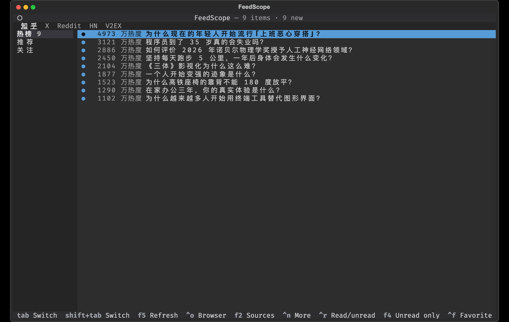

## Features

- **Multi-source aggregation**: Zhihu Hot / Recommend / Following, X For You / Following, Reddit Home / Popular / custom subreddits, HN Front / New / Ask / Show, V2EX Hot / Latest, Telegram channel subscriptions — one UI, `Tab` to switch
- **RSS subscriptions**: any RSS / Atom feed; the "All" stream merges by publish time (cross-feed dedup, a dead feed never drags others down); read feed-provided full text in-terminal; conditional requests keep refreshes polite to sources
- **Full in-terminal reading**: feed → question → answers → comments, loaded per layer on demand
- **Read state & offline**: the row-leading `●` marks an item unread and clears when you open it (`Ctrl+R` toggles back) — refreshes and restarts never touch it; the "N new" count lives in the status line; lists are cached locally, so restarts paint instantly and offline keeps them readable (RSS / Telegram details read offline too)
- **Favorites / read-later**: `Ctrl+F` stars the current item (from the list or while reading), `F3` opens the cross-source list; a full snapshot is stored — items stay readable after they scroll off hot lists or get deleted, and `feedscope favorites export` takes them with you (no lock-in)
- **HN discussion tree**: top-level comments as floors, reply trees one `Enter` deeper; deeply nested threads are flattened to two levels with `@parent` prefixes preserving who-replies-to-whom
- **Auto Grok translation for foreign posts on X**; media markers `[图片]` / `[视频]` are clickable links to the original image / video
- **Login loop**: in-app Chrome QR / password login when a source needs it; `Ctrl+U` to switch accounts
- **Enable sources on demand**: pick at first launch, `F2` anytime; site order = the order you tick
- **Bilingual UI (中文 / English)**: pick the language at first launch (pre-selected from your system), change anytime with `Ctrl+L` (applies after restart); message catalogs live in one file per language, and a new language is just one new TOML file
- **Editor-inspired theme**: VS Code Dark+ oriented dark palette, easy on the eyes for long reads
- **IME-friendly keys**: every binding is a non-printing key (Tab / arrows / function keys), works while a Chinese IME is active
- **Layout-change self-check**: 0 items parsed → immediate "site may have changed" error; `feedscope probe` inspects all sources and drops raw samples

## Screenshots

Zhihu Hot (feed sidebar on the left, meta column right-aligned and adaptive):

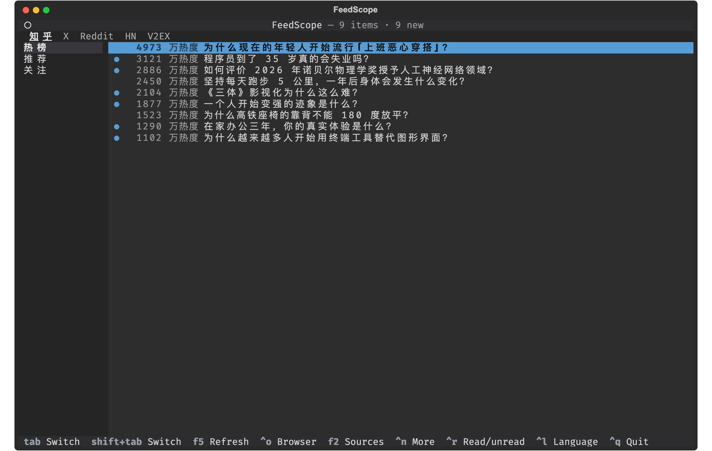

X For-You timeline (bylines show "name @handle" in full; media markers link to originals):

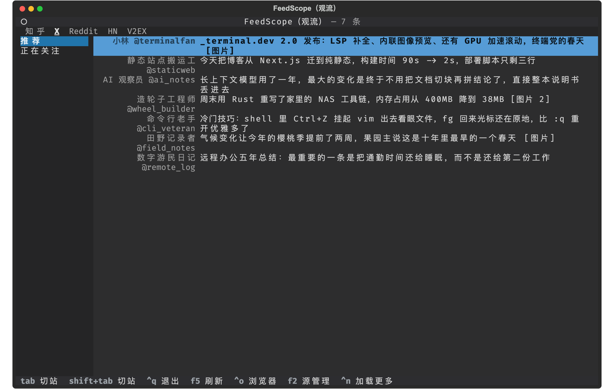

X post detail (media links, translation block, quoted post):

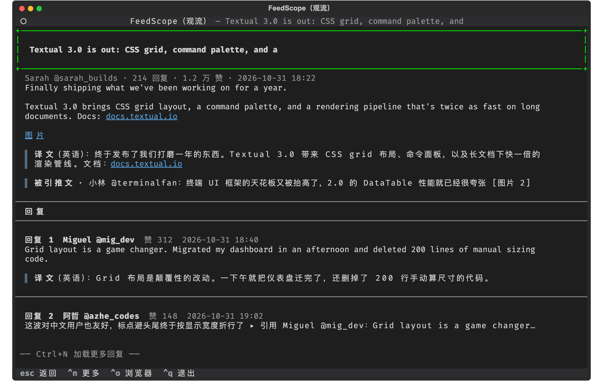

Reddit Popular (meta column "N pts · N comments · r/sub"; add subreddits in `F2`):

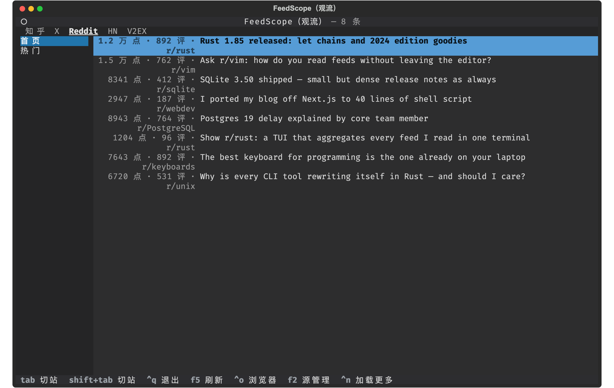

Reddit post detail (markdown self-text + comment floors with scores; moderator stickies flagged `[置顶]`):

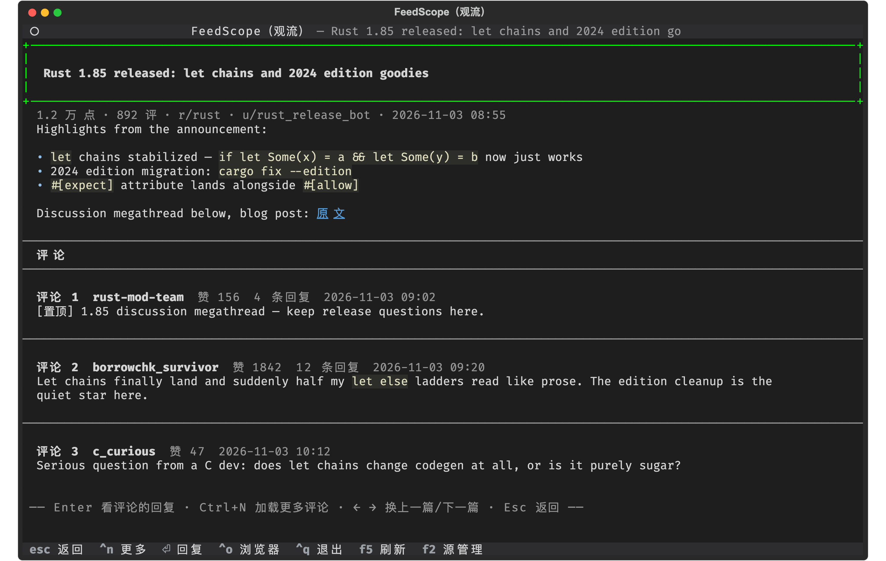

HN Front page (no login needed; "N pts · N comments · author" doubles as a discussion-heat radar):

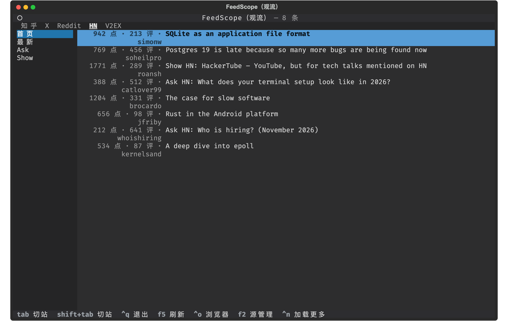

HN story detail (one-line article link + top-level comments as floors, each floor headed by "N replies"):

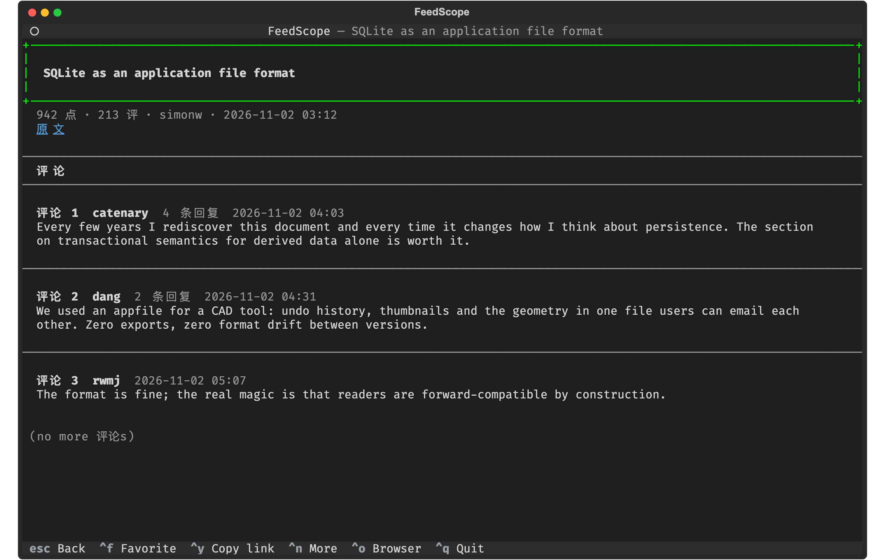

HN reply tree of one comment (deep threads flattened to two levels, cross-level replies carry an `@parent` prefix):

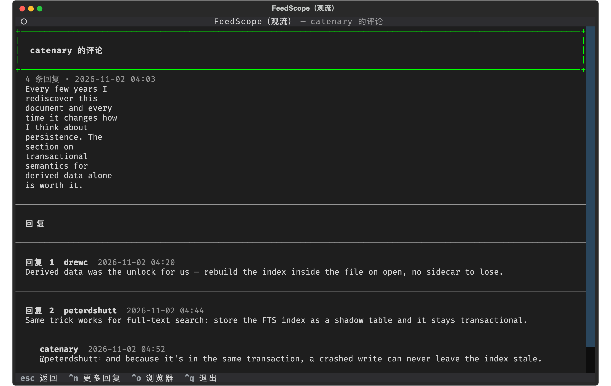

V2EX Hot (no login; the "node · N replies · user" meta column scans as board + heat at a glance):

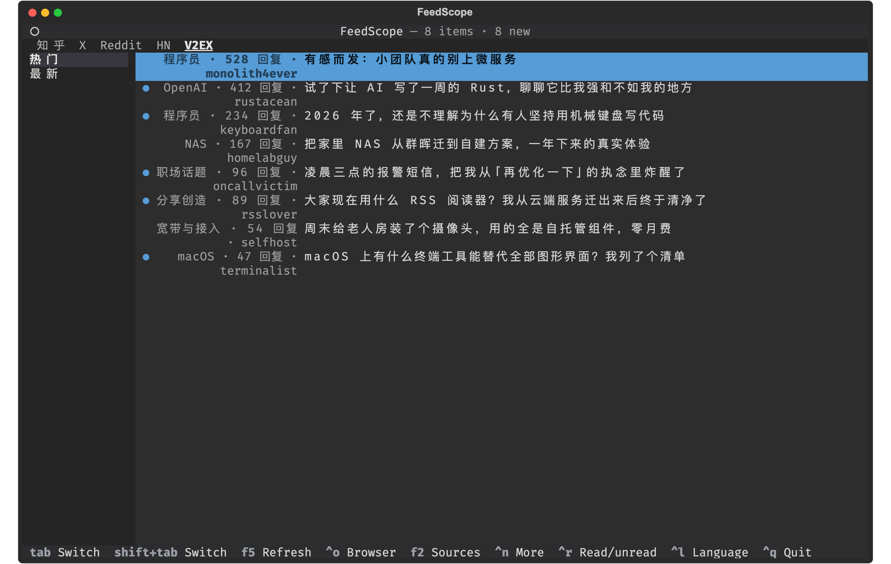

V2EX topic detail (markdown body + replies as floors; floor numbers match the site's floor culture):

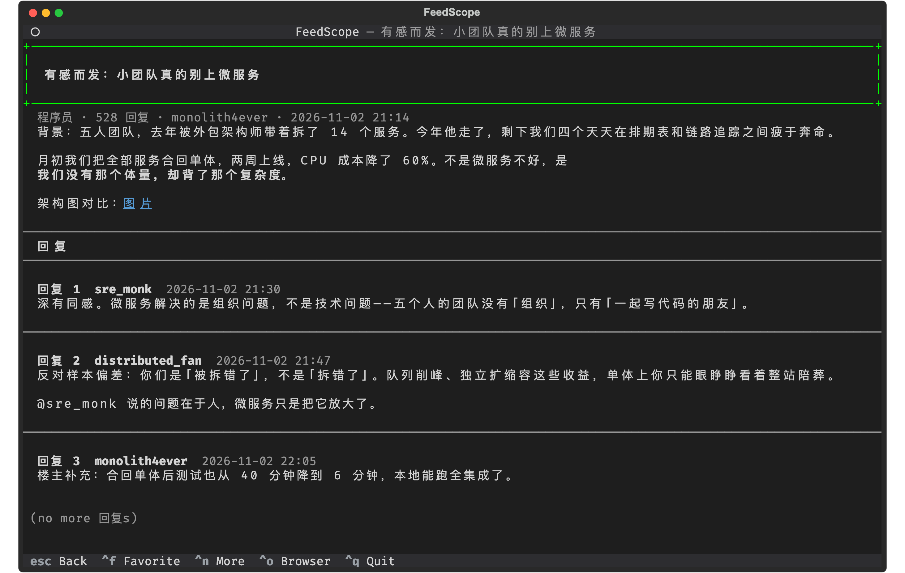

## Install

Requires Python 3.11+ and a local Google Chrome (no `playwright install` needed). macOS and Linux; Windows is not supported yet.

```bash
pipx install feedscope        # or: uv tool install feedscope
```

From source (development):

```bash
git clone https://github.com/howardli/FeedScope.git
cd FeedScope
uv sync                            # dev / test environment
uv tool install --editable .       # global `feedscope` command; code edits take effect immediately
```

- Run `feedscope doctor` after install to self-check the environment
- Slow PyPI? Use a mirror: `export UV_DEFAULT_INDEX=https://pypi.tuna.tsinghua.edu.cn/simple`
- Dev / test: `uv run feedscope` and `uv run pytest` — see [CONTRIBUTING](CONTRIBUTING.md)

## Usage

```bash
feedscope
```

### Keyboard

| Key | Action |
| --- | --- |
| `Tab` / `Shift+Tab` | Switch site (afterwards the keyboard lands in the left sidebar to pick a feed; `Enter` returns to the list) |
| `←` / `→` | Region moves: from the list `←` enters the sidebar (staying on the current feed) and `→` hits the right edge; from the sidebar `→` returns to the list and `←` goes to the source bar; in the source bar switches site in place; prev / next article in details; prev / next floor in reply layers |
| `↑` / `↓` | Move selection / scroll body; `↑` on the first row of any region climbs to the top source bar |
| `Enter` | Open detail; inside a detail, open the discussion layer of the floor you are reading; return to the list from the sidebar / source bar |
| `Ctrl+N` | Load more (list / floors / comments, each layer independently) |
| `Ctrl+O` | Open current item in browser |
| `Ctrl+R` | Toggle read / unread on the current item (mark it unread to revisit) |
| `Ctrl+F` | Favorite / unfavorite the current item (works while reading too) |
| `F3` | Favorites list: cross-source, newest first; Enter opens detail, Ctrl+F unfavorites |
| `F5` | Refresh |
| `Ctrl+U` | Account: login / logout |
| `Ctrl+L` | UI language: pick and save; restart `feedscope` to apply |
| `F2` | Manage sources: toggle enable / disable, saved on confirm; `→` opens subscription manager (RSS / Reddit / Telegram) |
| `Esc` | Go back one layer (from the sidebar / source bar, back to the list first) |
| `Ctrl+Q` | Quit (double `Ctrl+C` as fallback) |

All keys are non-printing — they work while a Chinese IME is active; typing printable characters by mistake shows a hint. The top tab bar and the left sidebar are clickable and drive the same code path as the keyboard. Arrow keys follow CLI conventions: `↑`/`↓` move the selection within the current list; `↑` on the first row of any region climbs to the source bar (the top region sits above everything), and `↓` from the source bar descends to the sidebar (inverse of the sidebar's first-feed `↑`); other region moves are horizontal — in the source bar `←`/`→` switches site in place; in the sidebar `↑`/`↓` switches feed in place, `→` returns to the list and `←` goes to the source bar; in the list `←` enters the sidebar (staying on the current feed) and `→` hits the right edge; `Enter` / `Esc` return to the list at any time. Dialogs (source manager / subscriptions / input / confirm / account) support the same arrow-key focus movement: `↓` past the bottom of the list enters the button row, `↑` returns to the list, `←`/`→` move between buttons, and `Enter` presses the focused button.

### Read state & offline

The dot column on each row tracks reading state: `●` unread (editor blue), blank = read. Unread is persistent — refreshes, feed switches and restarts never touch it; the dot only clears when you open the item (`Enter` into detail, `Ctrl+O` to the browser, or `←`/`→` article-stepping inside a detail). `Ctrl+R` toggles the current item — mark it unread to revisit. How many items arrived with this refresh shows as a count in the status line ("N items · M new"), not as row-level marks.

Favorites (`Ctrl+F`) store a **full snapshot at the moment of starring** (title/link/meta, and the body for RSS / Telegram) — items stay readable after they scroll off hot lists or get deleted. The `F3` list reads snapshots with zero requests (works offline); Enter fetches the latest comments from the original source. Favorited entries are exempt from the read-state cap; `feedscope favorites` lists them in the terminal and `feedscope favorites export [file.md]` exports Markdown to take them anywhere.

Both live in plain local files (delete to reset; no credentials involved):

| File | Contents |
| --- | --- |
| `state.json` (platform state dir, `~/.local/state/feedscope/` on Linux) | read/seen/favorite item ids with timestamps (capped at 10k entries, oldest evicted first; favorites exempt) |
| `favorites.json` (same state dir) | full snapshots of favorited items (user-curated data, never pruned) |
| `feeds/` (platform cache dir, `~/.cache/feedscope/feeds/` on Linux) | one JSON list cache per feed (200 items per feed, 60 most recent feeds kept) |

Startup and refresh paint the cache before fetching: restarts show the list instantly; offline or a broken site keeps the old content readable, and RSS / Telegram detail bodies travel with the cached list. `feedscope doctor` reports the state-file location.

### UI Language

The first launch asks for the language (pre-selected from your system locale; `Enter` to confirm, `Esc` keeps the default). Change it anytime with `Ctrl+L`; the choice is saved to the config and **takes effect when you restart `feedscope`** (counts and unit words are baked into fetched data in the process language, so a fixed-per-process language is the most robust model). **English is the default when no language is configured** — 中文用户在首启回车即选简体中文，或 `Ctrl+L` 随时切换。Subcommands (`doctor` / `probe` / `rss` / `login`) follow the same language as the TUI:

```toml
language = "zh-CN"   # or "en" (the default); delete the line to fall back to English (only a fresh install asks again)
```

Adding a language: copy `src/feedscope/core/i18n/en.toml` to `<code>.toml` (e.g. `ja.toml`), set its native name in `[meta]` (`name = "日本語"`) and translate the messages — the language picker discovers it automatically, no code changes. A parity test (`tests/test_i18n.py`) enforces identical key trees across catalogs, and an AST guard (`tests/test_i18n_no_hardcoded.py`) blocks hardcoded copy in `src`, so a missing translation turns the CI red.

### Login / Logout

Zhihu, X and Reddit require login (no anonymous feeds); HN, V2EX, RSS and Telegram work out of the box. Opening a logged-out source pops an in-app dialog; choosing "login" opens Chrome and auto-refreshes when done — no TUI restart. Dismiss it and you won't be asked again this session (`Ctrl+U` still works manually). `Ctrl+U` also switches accounts. From the CLI: `feedscope login [zhihu|x|reddit]`.

A session revoked server-side (password change, logout elsewhere, periodic rotation) never leaves you guessing: X's 401 is unambiguous (stale cookies dropped, re-login guided); Zhihu, Reddit and X all fetch through resident real-browser channel tabs (TLS, header order and cookies fully consistent with the login session, immune to non-browser-fingerprint blocking). Reddit's criterion is a local JWT decode of token_v2 (logged-in `sub="user"`, anonymous `sub="loid"`) — its login cookies are issued to anonymous traffic too (merely opening the login page sets one, so a cookie appearing ≠ login complete), while a local decode is zero-network and unforgeable. Both "login success" and the login gate use it, making a re-login loop structurally impossible.

### Sources

| Source | Feeds | Login |
| --- | --- | --- |
| Zhihu | Hot / Recommend / Following | ✅ |
| X (Twitter) | For You / Following | ✅ |
| Reddit | Home / Popular / custom subreddits | ✅ |
| HN | Front / New / Ask / Show | — |
| V2EX | Hot / Latest | — |
| RSS | All / one per subscription | — |
| Telegram | All / one per channel | — |

### Subcommands

```bash
feedscope [tui]           # start the TUI (default)
feedscope login [source]  # browser login (defaults to zhihu; e.g. x, reddit)
feedscope probe [source…] # inspect all sources; raw samples saved to disk
feedscope doctor          # environment self-check (Chrome / profile / config)
feedscope rss add <url> [--key k --label name]  # add: feed URL / site homepage (auto-discovered) / OPML path
feedscope rss list | remove <key>               # list / remove subscriptions
feedscope rss import <x.opml> | export [x.opml] # bulk import (idempotent merge) / export
feedscope favorites [export [x.md]]             # list favorites / export as Markdown (no lock-in)
```

### Source & Feed Config

First launch shows a picker; `F2` reopens it anytime. Selections are saved to user config (`~/.config/feedscope/sources.toml` on Linux; `FEEDSCOPE_CONFIG` overrides), which you can also hand-edit; restart to apply:

```toml
language = "zh-CN"  # UI language (maintained by first-run / Ctrl+L)
enabled = ["zhihu", "x", "reddit", "hn", "v2ex", "rss"]  # order = site order; remove an id to disable

[zhihu]
hide = ["follow"]    # hide built-in feeds you don't want

[reddit.feeds]       # subreddit table: key = feed name (names colliding with built-in home/popular are rejected)
rust = { label = "Rust", url = "https://www.reddit.com/r/rust/" }

[telegram.feeds]     # channel table: key = feed name (avoid the aggregate name all)
durov = { url = "https://t.me/durov/" }

[rss.feeds]          # RSS subscription table: key = feed name (avoid the reserved key all)
ruanyq = { label = "Ruanyifeng Weekly", url = "https://www.ruanyifeng.com/blog/atom.xml" }
hnrss = { url = "https://hnrss.org/newest?q=rust" }   # label defaults to key (keyword alerts still fit hnrss; for HN itself use the built-in source)

[rss]
hide = ["all"]       # hide the "All" aggregate, or a subscription key to hide one feed
```

Omitting `enabled` = everything enabled; saving from the manager preserves per-source `hide` sections and `feeds` tables (`[rss.feeds]` / `[reddit.feeds]` / `[telegram.feeds]`). To reorder sites: untick then re-tick in `F2` (moves to the end).

### RSS Subscriptions

Three ways to manage, pick any:

- **In the TUI (`F2`)**: on the RSS row press `→` to open the subscription manager — `Insert` add, `Enter` rename, `Delete` remove, `↑↓` select; changes save instantly; RSS re-ticks itself on return
- **CLI**: `feedscope rss add / list / remove`; migrating from another reader: `feedscope rss import subs.opml` (OPML from Feedly / Inoreader / NetNewsWire etc.; existing keys are skipped); `export` anytime so your subscriptions are never locked in
- **Hand-edit config**: edit the `[rss.feeds]` table (see above), then tick RSS in `F2`

Convenience behaviors of the add dialog (identical to `rss add`):

- Paste an RSS/Atom URL, **or a site homepage** — the declared feed is auto-discovered
- Paste **a local OPML path** = bulk import (drag the file into the terminal from Finder)
- Label defaults to the feed's own title (fetched once); add / import auto-enables RSS

With zero subscriptions RSS doesn't appear in the source list (`F2` can still open its manager to add the first one). Behavior notes:

- The "All" stream merges every subscription by publish time (newest first); the same URL across feeds (reposts / aggregators) is deduped; one dead feed only loses its own items, all dead = error
- Details read feed-provided content (`content` full text first, `summary` fallback); images become direct links; summary-only feeds show short bodies — `Ctrl+O` to read the rest in a browser
- Refreshes are conditional requests (ETag / Last-Modified) — unchanged feeds don't re-transfer bodies
- RSS has no login and no comment layer

### Hacker News

No login, no API key; data comes from the [public Algolia HN index](https://hn.algolia.com/api) (the same engine behind HN's own site search). Behavior notes:

- Same three-layer shape as Zhihu: story (link posts: body = one article link; Ask/Show: self-text in full) → top-level comments as floors → `Enter` opens a floor's reply tree
- Meta column shows "N pts · N comments · author"; deep threads flatten to two levels, cross-level replies carry an `@parent` prefix preserving the conversation thread
- The index lags a few minutes and lists are sorted by points (not official rank); floors with no replies don't advertise `Enter`

### V2EX

No login; data comes from official public v1 endpoints (hot / latest / replies, no token needed; [official API reference](https://www.v2ex.com/help/api)). Behavior notes:

- Two-layer shape: topic (markdown body; auto-embedded images become `[图片]` markers, `@` mentions become clickable links) → replies flattened as floors; V2EX replies have no nesting ("sub-replies" are just `@` text), so there is no third layer
- Meta column shows "node · N replies · user"; floor numbers match the site's floor culture, and a floor's permalink is the `#reply` anchor on the topic page
- The API returns everything in one shot (list fits a page, replies unpaginated) — floor paging costs zero requests; the body rides along with the list, so opening a detail costs exactly 1 request

### X (Twitter)

Login required; data comes from the web GraphQL endpoints — requests are issued by a resident browser tab's real Chrome (same channel design as Zhihu / Reddit: TLS, header order and cookies fully consistent with the login session; cf_clearance-style fingerprint blocking simply doesn't apply to in-page fetch). The endpoint queryIds rotate with X deploys: this source starts from snapshot constants and **self-heals by harvesting on failure** — on error it reopens the tab, collects the current deployment's JS chunks, greps out fresh queryIds and retries — turning X redesign days from "run a script and hand-copy constants" into "recovers automatically the same day". Behavior notes:

- Meta column shows "name @handle"; foreign-language tweets get an auto Grok translation block; media become clickable `[图片]` / `[视频]` markers to originals / direct video links
- Detail: full focal tweet + expanded quote chain; replies page along the ShowMore cursor; retweets (RT) jump to the original tweet's conversation
- Search is out: SearchTimeline's transaction-id gating requires a header only X's own JS computes — in-page fetch can't get in either

### Reddit

Login required; data comes from **the website's own HTML channel** — the legacy `.json` endpoints have been 403-only for third parties since 2026, so this source rides what the new frontend itself uses: listing pages as SSR HTML, pagination following the `faceplate-partial` load-after chain. Requests are issued by a resident browser tab's real Chrome (same channel design as Zhihu: TLS, header order and cookies fully consistent with the login session, immune to non-browser-fingerprint blocking); `x-reddit-client-version` is harvested from page responses automatically and self-heals on 403. Behavior notes:

- Same three-layer shape as HN: post (self posts: HTML converted to markdown; link posts: one article link; media posts: `[图片]` / `[视频]` markers to originals) → top-level comments as floors → `Enter` opens a floor's reply tree
- Login criterion: a local JWT decode of token_v2 (logged-in `sub="user"`, anonymous `sub="loid"`) — the mere "presence" of reddit_session/token_v2 can be produced by anonymous traffic; the decode is the hard proof. Login polling and the gate share this one check: zero network, zero forgery
- Meta column shows "N pts · N comments · r/sub"; floors carry scores, moderator stickies are flagged `[置顶]`; deep threads flatten to two levels with `@parent` prefixes (same as HN)
- "Home" aggregates the subreddits your Reddit account follows on the site (empty for a fresh account that follows nothing — expected); subscribe to what you want instead: `F2` → Reddit row → `→`, type a subreddit name or URL (`rust`, `r/rust`, a site link all work) and it becomes its own feed — no need to follow it on reddit.com
- The comment tree arrives in one request (huge threads are truncated) with "N more collapsed" hints where cut; floor / reply paging is all in-memory, zero extra requests

### Telegram Channels

No login; data comes from each channel's public web preview (`t.me/s/<channel>`, server-rendered HTML readable as long as the owner keeps preview on). Behavior notes:

- Pure subscription source shaped exactly like RSS: `F2` → Telegram row → `→` opens the manager; type a channel name or link (`durov`, `@durov`, `t.me/durov`, even a post link); label defaults to the channel's own name
- The "All" stream merges every channel by publish time (newest first), one dead channel only loses its own items; each channel is also its own feed (individually hideable)
- Meta column "N views" is the channel-post heat radar; the "All" stream labels each row's origin in a dedicated source-tag column (same as the favorites list); inline HTML becomes markdown, images/videos become `[图片]` / `[视频]` markers (videos have no direct link — the marker points to the post page)
- Details read list-carried content (zero requests); `Ctrl+N` in a single-channel feed pages back through history via the `?before=` cursor; no comment layer (channel discussion groups aren't in the preview)

## Community

- **Bugs & features** — [issues](https://github.com/howardli/FeedScope/issues): the bug template asks for `feedscope doctor` output, which carries version + environment in a few lines
- **Questions & chat** — [discussions](https://github.com/howardli/FeedScope/discussions)
- **Code** — [CONTRIBUTING](CONTRIBUTING.md): adding a new source is designed to be a one-package change, and a new UI language is one TOML file
- **Security** — [SECURITY.md](SECURITY.md): where your login cookies live and how to report issues privately
- **Changelog** — [CHANGELOG.md](CHANGELOG.md)

Status: **0.x, active development.** Config may gain fields between minors; breaking changes wait for 1.0. A site redesign can break its source at any time — `feedscope probe` pinpoints it, patch releases ship updated parsers.

## Disclaimer

This project accesses Zhihu, X and Reddit web APIs through your local browser session, for personal learning and research only:

- Follow the laws of your region and each site's user agreements; account-risk is your own
- Ships with no credentials; login state stays in the local browser profile and is never shared
- Breakage from site redesigns is expected wear (`feedscope probe` helps locate them); do not use for bulk scraping or commercial purposes

## License

[MIT](LICENSE)
