# FeedScope

[](https://pypi.org/project/feedscope/)
[](https://pypi.org/project/feedscope/)
[](LICENSE)
[](https://github.com/howardli/FeedScope/actions/workflows/ci.yml)

> Terminal-first feed reader — Zhihu, X (Twitter), Reddit, Hacker News, V2EX, RSS and Telegram channels, all in one terminal.

**Language**: English · [中文](README.zh-CN.md)

[Install](#install) · [Keyboard](#keyboard) · [Sources](#sources) · [Config](#source--feed-config) · [Roadmap](#roadmap) · [Changelog](CHANGELOG.md)

## Demo

Zhihu Hot → X timeline → post detail (auto translation, quoted post) → Reddit → post detail → HN → story detail → reply tree → V2EX → topic detail — everything below is just `Tab` and `Enter`:

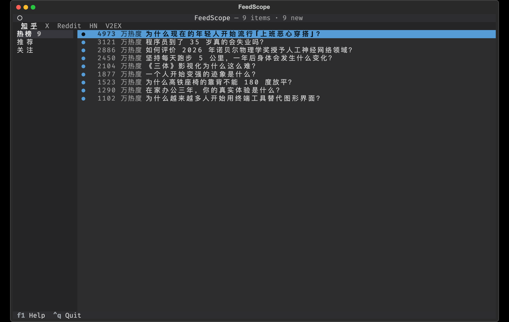

## Quick start

Requires Python 3.11+ and a local Google Chrome; macOS and Linux (Windows not yet supported).

```bash
pipx install feedscope   # or: uv tool install feedscope
feedscope                # Tab switches site, Enter opens detail
```

Run `feedscope doctor` afterwards to self-check the environment. From-source install and mirror tips: [Install](#install).

## Why FeedScope?

- **Login-walled sources through your own browser** — Zhihu, X and Reddit fetch through a resident real-Chrome tab: TLS, header order and cookies are identical to your login session, so non-browser-fingerprint blocking simply doesn't apply. Unlike typical terminal RSS readers, FeedScope reads the sources you actually browse — no API keys, no scraping proxies
- **Survives site churn** — X's rotating GraphQL queryIds are re-harvested automatically from the live deployment on failure; Reddit's client-version header self-heals on 403; `feedscope probe` pinpoints any breakage in one command
- **Truly local** — read state, favorites and list caches live in plain local files; no account, no telemetry; `feedscope favorites export` takes your saved items anywhere (no lock-in)
- **Reading state that sticks** — unread dots survive refreshes and restarts; restarts paint the cache instantly, and offline keeps lists (and RSS / Telegram bodies) readable
- **Built to last** — 631 offline tests, mypy strict throughout, bilingual UI (中文 / English), IME-friendly non-printing keys; a new theme or a new language is one TOML file, auto-discovered

## Features

**Sources**

- Multi-source aggregation: Zhihu Hot / Recommend / Following, X For You / Following, Reddit Home / Popular / custom subreddits, HN Front / New / Ask / Show, V2EX Hot / Latest, Telegram channel subscriptions — one UI, `Tab` to switch
- RSS / Atom subscriptions: the "All" stream merges by publish time (cross-feed dedup; a dead feed never drags others down), feed-provided full text reads in-terminal, conditional requests keep refreshes polite to sources
- Enable sources on demand: pick at first launch, `F2` anytime; site order = the order you tick

**Reading**

- Full in-terminal reading: feed → question → answers → comments, each layer loaded on demand
- Keyboard link following: `Ctrl+G` lists the links in what you are reading (`[image]`, `@mentions`, the original article…) — ↑↓ pick, Enter opens in the browser; no mouse needed
- Local search: `F6` searches every cached list and your favorites as you type (titles for all sources, bodies for RSS / Telegram) — zero requests
- Unread triage anywhere: `]` / `[` / `Ctrl+R` also work inside a detail (jump to the next unread article, mark the current one unread to revisit) and on the favorites list
- Resumes where you left off: a restart lands on the same source, feed and selected item — located by id, so items that arrived above it in the meantime don't matter (if it has scrolled off, the list starts at the top). The position is saved when you quit and whenever you open an item
- Read state & offline: the row-leading `●` marks an item unread and clears when you open it (`Ctrl+R` toggles back); the "N new" count lives in the top status line; lists cache locally — restarts paint instantly and offline keeps them readable (RSS / Telegram details read offline too)
- Favorites / read-later: `Ctrl+F` stars the current item (from the list or while reading), `F3` opens the cross-source list; the snapshot stays readable after items scroll off hot lists, and when you star from a reading screen the detail you had loaded is saved too — a post that was deleted or cannot be opened later shows that copy instead of a dead link. `feedscope favorites export` takes them with you (no lock-in)
- HN discussion tree: top-level comments as floors, reply trees one `Enter` deeper; deeply nested threads flatten to two levels with `@parent` prefixes preserving who-replies-to-whom
- X extras: auto Grok translation for foreign posts; `[图片]` / `[视频]` media markers are clickable links to the original image / video
- Login loop: in-app Chrome QR / password login when a source needs it; `Ctrl+U` to switch accounts

**Terminal-native**

- Bilingual UI (中文 / English): pick the language at first launch (pre-selected from your system), change anytime with `Ctrl+L` (applies after restart); message catalogs live in one file per language
- Editor-inspired dual themes: dark (VS Code Dark+ oriented, the default) and light (Light+ oriented), switched live with `Ctrl+T`; read items get a dimmed title so read/unread separates at a glance; `Ctrl+Y` copies an item's link from any layer
- IME-friendly keys: primary bindings are non-printing keys (Tab / arrows / function keys), safe while a Chinese IME is active; a few list actions use ASCII keys (`]` `[` `/` `,` `.`)
- Layout-change self-check: 0 items parsed → immediate "site may have changed" error; `feedscope probe` inspects all sources and drops raw samples

## Screenshots

Zhihu Hot (feed sidebar on the left, meta column right-aligned and adaptive):

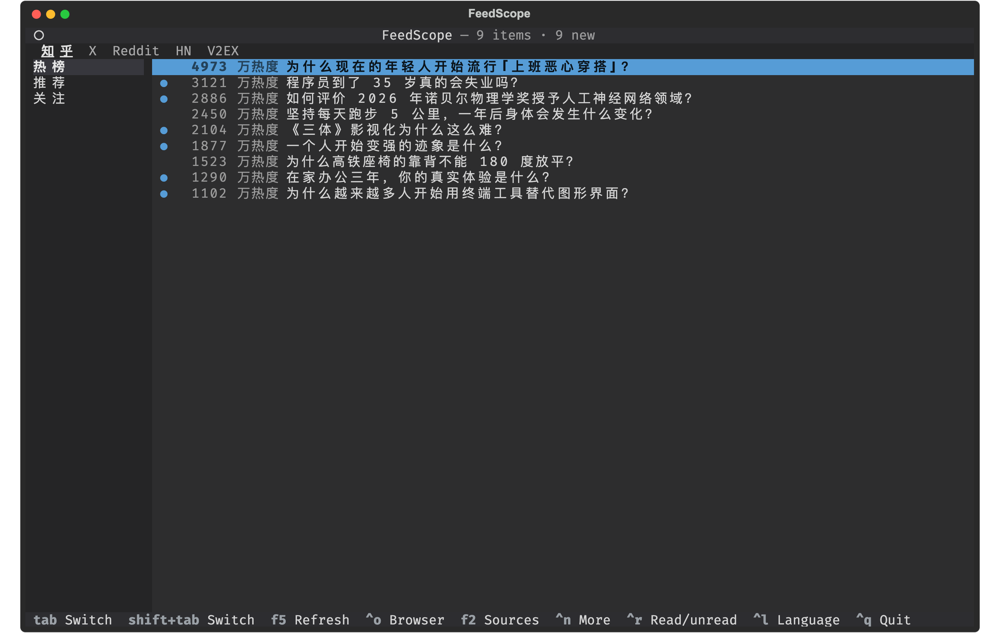

X For-You timeline (bylines show "name @handle" in full; media markers link to originals):

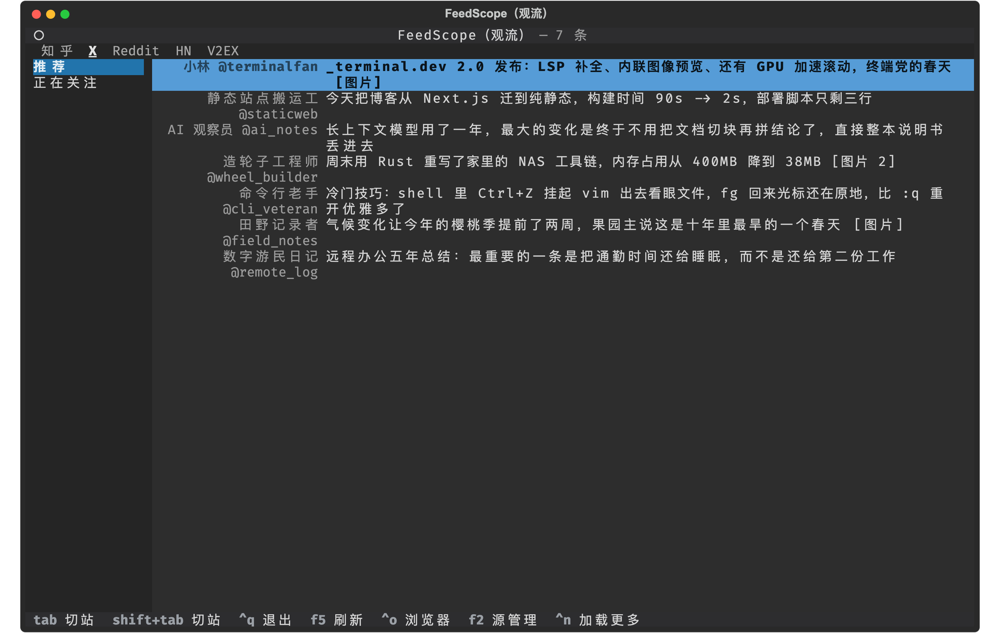

X post detail (media links, translation block, quoted post):

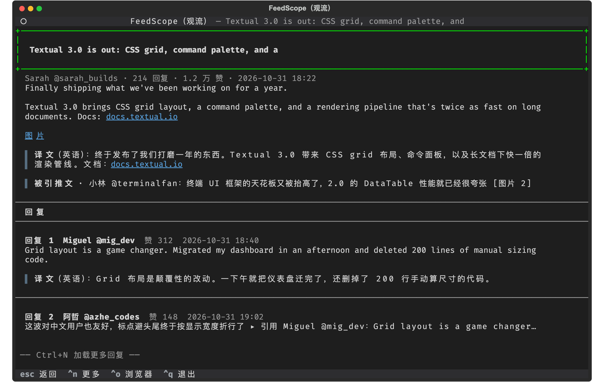

Reddit Popular (meta column "N pts · N comments · r/sub"; add subreddits in `F2`):

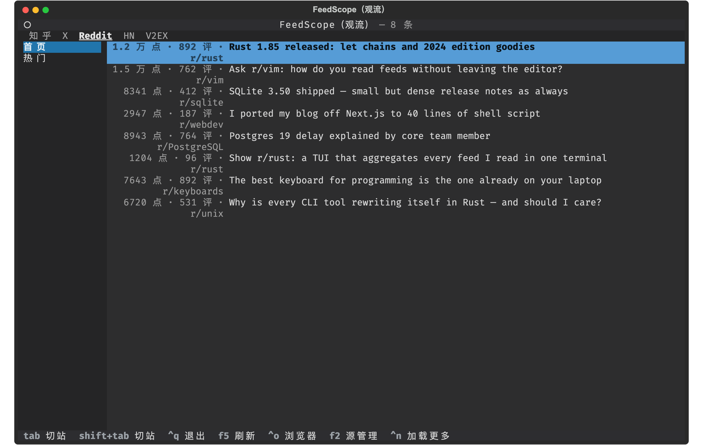

Reddit post detail (markdown self-text + comment floors with scores):

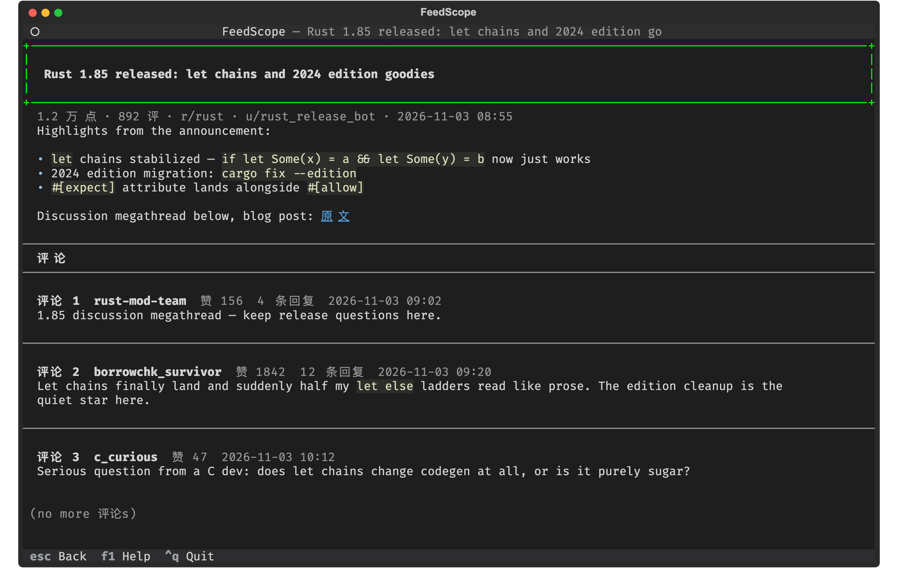

HN Front page (no login needed; "N pts · N comments · author" doubles as a discussion-heat radar):

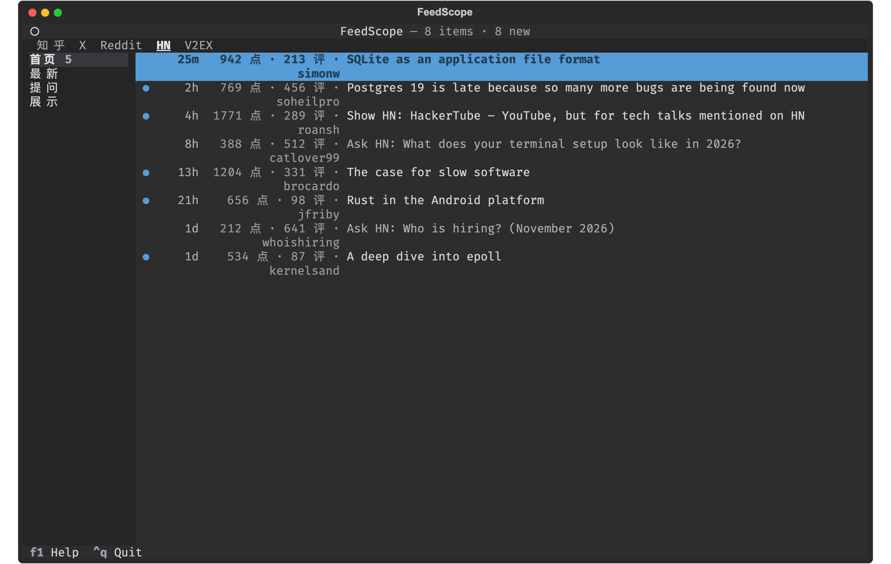

HN story detail (one-line article link + top-level comments as floors, each floor headed by "N replies"):

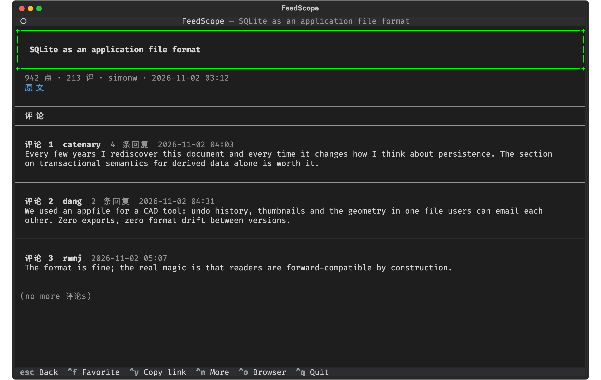

HN reply tree of one comment (deep threads flattened to two levels, cross-level replies carry an `@parent` prefix):

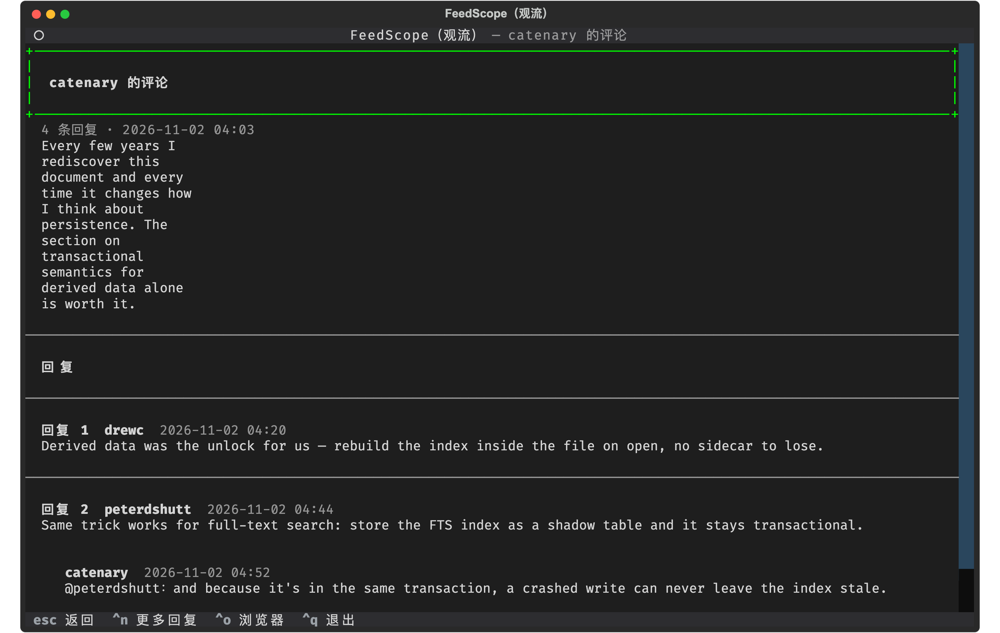

V2EX Hot (no login; the "node · N replies · user" meta column scans as board + heat at a glance):

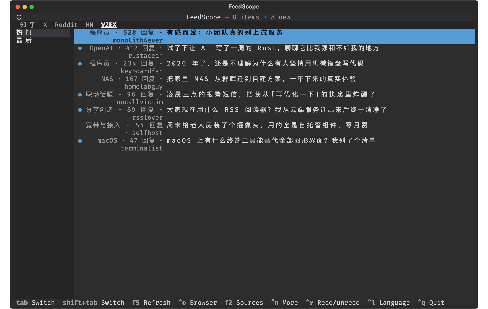

V2EX topic detail (markdown body + replies as floors; floor numbers match the site's floor culture):

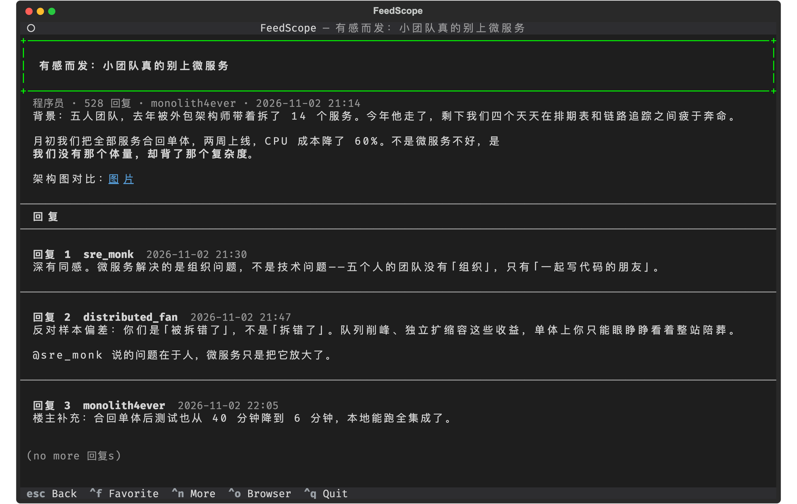

## Install

Requires Python 3.11+ and a local Google Chrome (no `playwright install` needed). macOS and Linux; Windows is not supported yet.

```bash
pipx install feedscope        # or: uv tool install feedscope
```

From source (development):

```bash
git clone https://github.com/howardli/FeedScope.git
cd FeedScope
uv sync                            # dev / test environment
uv tool install --editable .       # global `feedscope` command, works from any directory; code edits take effect immediately
```

- Run `feedscope doctor` after install to self-check the environment
- Slow PyPI? Use a mirror: `export UV_DEFAULT_INDEX=https://pypi.tuna.tsinghua.edu.cn/simple`
- Dev / test: `uv run feedscope` and `uv run pytest` — see [CONTRIBUTING](CONTRIBUTING.md)

## Usage

```bash
feedscope
```

### Keyboard

| Key | Action |
| --- | --- |
| `Tab` / `Shift+Tab` | Switch site (afterwards the keyboard lands in the left sidebar to pick a feed; `Enter` returns to the list; if focus is already in the source bar, `Tab` keeps switching in place) |
| `←` / `→` | Region moves: from the list `←` enters the sidebar (staying on the current feed) and `→` hits the right edge; from the sidebar `→` returns to the list and `←` goes to the source bar; in the source bar switches site in place; prev / next article in details; prev / next floor in reply layers |
| `↑` / `↓` | Move selection / scroll body; `↑` on the first row of any region climbs to the top source bar |
| `Home` / `End` / `PgUp` / `PgDn` | Scroll the list viewport (list pane only) |
| `Enter` | Open detail; inside a detail, open the discussion layer of the floor you are reading; return to the list from the sidebar / source bar |
| `Ctrl+N` | Load more (list / floors / comments, each layer independently) |
| `Ctrl+O` | Open current item in browser |
| `Ctrl+Y` | Copy the current item's link (in details, copies the article you are reading; in reply layers, the floor-direct link) |
| `Ctrl+G` | Open a link in the body: lists the links of what you are reading (`[image]`, `@mentions`, the original); ↑↓ select, Enter opens in the browser |
| `Ctrl+R` | Toggle read / unread on the current item (mark it unread to revisit; also while reading and on the favorites list) |
| `F4` | Unread-only view: the list shows unread items only (session toggle; read rows vanish instantly) |
| `]` / `[` | Jump to the next / previous unread item (wraps around the current feed; inside a detail it loads the next unread article; also on the favorites list and search results) |
| `/` | Filter the list by title (case-insensitive substring; empty input clears; also works in the favorites list) |
| `Ctrl+A` | Mark every item in the current feed as read (with confirmation) |
| `Ctrl+F` | Favorite / unfavorite the current item (works while reading too) |
| `F3` | Favorites list: cross-source, newest by star time; Enter opens detail, Ctrl+F unfavorites |
| `F5` | Refresh |
| `F6` | Search cached lists and favorites as you type (titles for every source, bodies for RSS / Telegram); ↑↓ select, Enter opens, Esc goes back |
| `Ctrl+U` | Account: login / logout |
| `Ctrl+L` | UI language: pick and save; restart `feedscope` to apply |
| `Ctrl+T` | UI theme: pick, applied instantly and saved (no restart needed) |
| `F2` | Manage sources: `Space` / `Enter` toggles enable / disable, saved on confirm; `→` opens subscription manager (RSS / Reddit / Telegram) |
| `Esc` | Go back one layer (from the sidebar / source bar, back to the list first) |
| `F1` | Keybinding help: the full keymap for the global scope and the current screen (the footer shows only `F1` / `Esc`; everything else lives here; `Enter` / `F1` closes it) |
| `Ctrl+Q` | Quit (`Ctrl+C` shows a hint pointing to `Ctrl+Q`; it does not quit by itself) |

Primary keys are non-printing — they work while a Chinese IME is active (the few ASCII-key actions: `]` `[` `/` `,` `.`). Typing CJK characters by mistake (an IME leak) shows a hint. The top tab bar and the left sidebar are clickable and drive the same code path as the keyboard.

Arrow keys follow CLI conventions:

- `↑` / `↓` move the selection within the current list; `↑` on the first row of any region climbs to the top source bar (the top region sits above everything), and `↓` from the source bar descends to the sidebar (inverse of the sidebar's first-feed `↑`)
- Other region moves are horizontal: in the list `←` enters the sidebar (staying on the current feed) and `→` hits the right edge; in the sidebar `↑` / `↓` switches feed in place, `→` returns to the list and `←` goes to the source bar; in the source bar `←` / `→` switches site in place
- `Enter` / `Esc` return to the list at any time
- Dialogs (source manager / subscriptions / input / confirm / account) support the same arrow-key focus movement: `↓` past the bottom of the list enters the button row, `↑` returns to the list, `←` / `→` move between buttons, and `Enter` presses the focused button

### Read state & offline

The dot column on each row tracks reading state: `●` unread (editor blue), blank = read. Unread is persistent — refreshes, feed switches and restarts never touch it; the dot only clears when you open the item (`Enter` into detail, `Ctrl+O` to the browser, or `←`/`→` article-stepping inside a detail). `Ctrl+R` toggles the current item — mark it unread to revisit. How many items arrived with this refresh shows as a count in the top status line ("N items · M new"), not as row-level marks.

The unread-digestion trio: every feed in the sidebar carries an **unread badge** (counted on refresh, decremented live as you read — including reads from the favorites list); `F4` is the **unread-only view** (session toggle, read rows vanish instantly — the main path for working through a backlog); `Ctrl+A` **marks the current feed read** with a light confirmation.

Favorites (`Ctrl+F`) store a **full snapshot at the moment of starring** (title/link/meta, and the body for RSS / Telegram) — items stay readable after they scroll off hot lists or get deleted. Starring from a reading screen also saves **the detail you had loaded** (body, answers and reply trees): when the original can no longer be opened — deleted, offline, the source is gone — Enter shows that saved copy with a notice instead of a dead end. The `F3` list reads snapshots with zero requests (works offline); Enter fetches the latest from the original source and falls back to the saved copy. Favorited entries are exempt from the read-state cap; `feedscope favorites` lists them in the terminal and `feedscope favorites export [file.md]` exports Markdown to take them anywhere.

All of these are plain local files (delete to reset; no credentials involved):

| File | Contents |
| --- | --- |
| `state.json` (platform state dir, `~/.local/state/feedscope/` on Linux) | read/seen/favorite item ids, timestamps and per-feed unread counts (capped at 10k entries, oldest evicted first; favorites exempt), plus the last reading position (source / feed / selected item) |
| `favorites.json` (same state dir) | full snapshots of favorited items (user-curated data, never pruned), plus the detail saved when starring from a reading screen |
| `feedscope.lock` (same state dir) | empty lock file: lets a second `feedscope` on the same state warn that the two will overwrite each other's read marks (nothing is blocked) |
| `feeds/` (platform cache dir, `~/.cache/feedscope/feeds/` on Linux) | one JSON list cache per feed (200 items per feed, 60 most recent feeds kept) |

Startup and refresh paint the cache before fetching: restarts show the list instantly; offline or a broken site keeps the old content readable, and RSS / Telegram detail bodies travel with the cached list. `feedscope doctor` reports the state-file location. If `state.json` or `favorites.json` is unreadable (truncated, hand-edited badly), it is renamed to `<name>.corrupt-<timestamp>` instead of being overwritten and the app continues from an empty state; `feedscope doctor` lists the kept-aside files so you can recover them by hand.

### UI Language

The first launch asks for the language (pre-selected from your system locale; `Enter` to confirm, `Esc` keeps the default). Change it anytime with `Ctrl+L`; the choice is saved to the config and **takes effect when you restart `feedscope`** (counts and unit words are baked into fetched data in the process language, so a fixed-per-process language is the most robust model). **English is the default when no language is configured** — 中文用户在首启回车即选简体中文，或 `Ctrl+L` 随时切换。Subcommands (`doctor` / `probe` / `rss` / `login` / `favorites` / `cache`) follow the same language as the TUI:

```toml
language = "zh-CN"   # or "en" (the default); delete the line to fall back to English (only a fresh install asks again)
```

Adding a language: copy `src/feedscope/core/i18n/en.toml` to `<code>.toml` (e.g. `ja.toml`), set its native name in `[meta]` (`name = "日本語"`) and translate the messages — the language picker discovers it automatically, no code changes. A parity test (`tests/test_i18n.py`) enforces identical key trees across catalogs, and an AST guard (`tests/test_i18n_no_hardcoded.py`) blocks hardcoded copy in `src`, so a missing translation turns the CI red.

### UI theme

`Ctrl+T` switches anytime — **applied instantly and saved** (unlike language's restart model: a theme is pure presentation). Built-ins are `editor-dark` (default) and `editor-light`; set it manually in the config with `theme = "editor-light"` (delete the line to fall back to the dark default). Adding a theme: copy `src/feedscope/ui/themes/editor-dark.toml` and recolor — it is auto-discovered with zero code changes; completeness is pinned by `tests/test_theme.py`.

### Display timezone

Timestamps (list rows' relative-time column, detail headers) render in **Beijing time (UTC+8) by default** — deliberately not the machine's local timezone, so the same content reads identically on a server or an overseas laptop. Set an IANA name in the config to change it:

```toml
timezone = "Asia/Tokyo"   # any IANA name; delete the line / bad value = back to UTC+8
```

Like language, it is fixed per process (formatted times are baked into the list cache; the raw `published` timestamps behind the time column always follow the current setting). Sources without list timestamps (Zhihu hot/recommend) simply don't grow the column.

### Login / Logout

Zhihu, X and Reddit require login (no anonymous feeds); HN, V2EX, RSS and Telegram work out of the box. Opening a logged-out source pops an in-app dialog; choosing "login" opens Chrome and auto-refreshes when done — no TUI restart. Dismiss it and you won't be asked again this session (`Ctrl+U` still works manually). `Ctrl+U` also switches accounts. From the CLI: `feedscope login [zhihu|x|reddit]`. Login sessions live in a local Chrome profile (`~/.cache/feedscope/chromium-profile/` on Linux) — see [SECURITY](SECURITY.md). While the sign-in window is open, HN / V2EX / RSS / Telegram keep working; Zhihu / X / Reddit pause until it closes.

A session revoked server-side (password change, logout elsewhere, periodic rotation) never leaves you guessing: X's 401 is unambiguous (stale cookies dropped, re-login guided); a half-revoked Zhihu session keeps serving the list while detail endpoints answer 403 (observed in the wild), so those endpoints likewise turn it into re-login guidance instead of a bare HTTP code — in the detail, answer and comment layers — and once a stale session has been detected, `Ctrl+U` offers sign-in directly (the leftover cookie would otherwise fool the check into offering logout first); Zhihu, Reddit and X all fetch through resident real-browser channel tabs (TLS, header order and cookies fully consistent with the login session, immune to non-browser-fingerprint blocking). Reddit's criterion is a local JWT decode of token_v2 (logged-in `sub="user"`, anonymous `sub="loid"`) — its login cookies are issued to anonymous traffic too (merely opening the login page sets one, so a cookie appearing ≠ login complete), while a local decode is zero-network and unforgeable. Both "login success" and the login gate use it, making a re-login loop structurally impossible.

### Sources

| Source | Feeds | Login |
| --- | --- | --- |
| Zhihu | Hot / Recommend / Following | ✅ |
| X (Twitter) | For You / Following | ✅ |
| Reddit | Home / Popular / custom subreddits | ✅ |
| HN | Front / New / Ask / Show | — |
| V2EX | Hot / Latest | — |
| RSS | All / one per subscription | — |
| Telegram | All / one per channel | — |

### Subcommands

```bash
feedscope [tui]           # start the TUI (default)
feedscope login [source]  # browser login (defaults to zhihu; e.g. x, reddit)
feedscope probe [source…] # inspect all sources; raw samples saved to disk
feedscope doctor          # environment self-check (Chrome / profile / config / state / logs)
feedscope cache [clear]   # list-cache report / wipe it (purely derived, lossless)
feedscope rss add <url> [--key k --label name]  # add: feed URL / site homepage (auto-discovered) / OPML path
feedscope rss list | remove <key>               # list / remove subscriptions
feedscope rss rename <key> <name>               # rename a subscription's display name
feedscope rss import <x.opml> | export [x.opml] # bulk import (idempotent merge) / export
feedscope favorites [export [x.md]]             # list favorites / export as Markdown (no lock-in)
```

Global flags: `--verbose` (log file goes to DEBUG; subcommands also mirror to stderr), `--log-file <path>` (write the log elsewhere) and `--version`. `rss export` / `favorites export` with no file argument print to stdout (redirect-friendly).

Environment variables: `FEEDSCOPE_NO_PREWARM=1` starts up without pre-launching the browser (for slow machines); `FEEDSCOPE_SAMPLE_DIR=<dir>` dumps raw responses to disk during normal runs too (the same samples `probe` collects); `FEEDSCOPE_CONFIG` / `FEEDSCOPE_LOG_FILE` relocate the config / log file.

Exit codes (script-friendly): `probe` exits 1 when a probe fails and 2 on unknown source ids; `rss add` / `rss import` exit 2 on an unreadable OPML, and `add` also exits 1 on a subscription conflict; `doctor` exits 1 when the self-check fails — Chrome missing, an unreadable `sources.toml`, or settings that would silently not take effect (unknown source ids in `enabled`, `hide` names matching no feed, unknown `language` / `timezone`, subscription entries without a url …); each problem is listed on its own line.

### Troubleshooting & logs

Every run writes a log file (INFO level) at the location `feedscope doctor` reports — `$HOME/Library/Logs/feedscope/feedscope.log` on macOS, `~/.local/state/feedscope/log/feedscope.log` on Linux — rotated at 1 MB ×3. When something misbehaves, that file usually already holds the answer: fetch failures with tracebacks, self-heal paths (X queryId re-harvest, Reddit version header) that quietly fell back, login-detector errors. `--verbose` raises it to DEBUG for the chatty detail; `FEEDSCOPE_LOG_FILE` relocates it for good. Inside the TUI nothing ever prints to stderr (it would corrupt the redraw), so the file is the one place to look.

Two `feedscope` processes on the same data: the browser profile is protected — a process that finds the profile lock owned by a live one refuses to start Chrome and names the pid; the state files are not locked, so a second TUI instance on the same state warns that read marks and favorites will overwrite each other.

### Source & Feed Config

First launch shows a picker; `F2` reopens it anytime. Selections are saved to user config (`~/.config/feedscope/sources.toml` on Linux; `FEEDSCOPE_CONFIG` overrides), which you can also hand-edit; restart to apply:

```toml
language = "zh-CN"  # UI language (maintained by first-run / Ctrl+L)
browser = "open -a Firefox"   # optional: command that opens links (%u = the URL); default = the system browser
clipboard = "pbcopy"          # optional: command that reads text from stdin; default = auto-detected, else the terminal's OSC 52
enabled = ["zhihu", "x", "reddit", "hn", "v2ex", "rss"]  # order = site order; remove an id to disable

[zhihu]
hide = ["follow"]    # hide built-in feeds you don't want

[reddit.feeds]       # subreddit table: key = feed name (names colliding with built-in home/popular are rejected)
rust = { label = "Rust", url = "https://www.reddit.com/r/rust/" }

[telegram.feeds]     # channel table: key = feed name (avoid the aggregate name all)
durov = { url = "https://t.me/durov/" }

[rss.feeds]          # RSS subscription table: key = feed name (avoid the reserved key all)
ruanyq = { label = "Ruanyifeng Weekly", url = "https://www.ruanyifeng.com/blog/atom.xml" }
hnrss = { url = "https://hnrss.org/newest?q=rust" }   # label defaults to key (keyword alerts still fit hnrss; for HN itself use the built-in source)

[rss]
hide = ["all"]       # hide the "All" aggregate, or a subscription key to hide one feed
```

Omitting `enabled` = everything enabled; saving from the manager preserves per-source `hide` sections and `feeds` tables (`[rss.feeds]` / `[reddit.feeds]` / `[telegram.feeds]`) — and since 0.4.0 it also preserves hand-written comments and unknown keys verbatim (tomlkit round-trip). To reorder sites: highlight a ticked source in `F2` and nudge with `,` / `.` (untick-then-tick still moves to the end). `browser` / `clipboard` matter on SSH or headless hosts, where the defaults cannot reach a browser or clipboard: set them to a command that works there (e.g. `clipboard = "tmux load-buffer -"`), or copy links with `Ctrl+Y`. `feedscope doctor` reports settings that would silently not take effect.

### RSS Subscriptions

Three ways to manage, pick any:

- **In the TUI (`F2`)**: on the RSS row press `→` to open the subscription manager — `Insert` add, `Enter` rename, `Delete` remove, `↑↓` select; changes save instantly; RSS re-ticks itself on return
- **CLI**: `feedscope rss add / list / remove`; migrating from another reader: `feedscope rss import subs.opml` (OPML from Feedly / Inoreader / NetNewsWire etc.; existing keys are skipped); `export` anytime so your subscriptions are never locked in
- **Hand-edit config**: edit the `[rss.feeds]` table (see above), then tick RSS in `F2`

Convenience behaviors of the add dialog (identical to `rss add`):

- Paste an RSS/Atom URL, **or a site homepage** — the declared feed is auto-discovered
- Paste **a local OPML path** = bulk import (drag the file into the terminal from Finder)
- Label defaults to the feed's own title (fetched once); add / import auto-enables RSS

With zero subscriptions RSS doesn't appear in the source list (`F2` can still open its manager to add the first one). Behavior notes:

- The "All" stream merges every subscription by publish time (newest first); the same URL across feeds (reposts / aggregators) is deduped; one dead feed only loses its own items, all dead = error
- Details read feed-provided content (`content` full text first, `summary` fallback); images become direct links; summary-only feeds show short bodies — `Ctrl+O` to read the rest in a browser
- Refreshes are conditional requests (ETag / Last-Modified) — unchanged feeds don't re-transfer bodies
- JSON Feed is understood too (`feed+json` was already accepted by auto-discovery); relative links and image URLs inside a body are resolved against the entry's own page, and enclosures (podcasts, video feeds) appear after the body as `[audio]` / `[video]` / `[file]` links
- RSS has no login and no comment layer

### Hacker News

No login, no API key; data comes from the [public Algolia HN index](https://hn.algolia.com/api) (the same engine behind HN's own site search). Behavior notes:

- Same three-layer shape as Zhihu: story (link posts: body = one article link; Ask/Show: self-text in full) → top-level comments as floors → `Enter` opens a floor's reply tree
- Meta column shows "N pts · N comments · author"; deep threads flatten to two levels, cross-level replies carry an `@parent` prefix preserving the conversation thread
- The index lags a few minutes and lists are sorted by points (not official rank); floors with no replies don't advertise `Enter`

### V2EX

No login; data comes from official public v1 endpoints (hot / latest / replies, no token needed; [official API reference](https://www.v2ex.com/help/api)). Behavior notes:

- Two-layer shape: topic (markdown body; auto-embedded images become `[图片]` markers, `@` mentions become clickable links) → replies flattened as floors; V2EX replies have no nesting ("sub-replies" are just `@` text), so there is no third layer
- Meta column shows "node · N replies · user"; floor numbers match the site's floor culture, and a floor's permalink is the `#reply` anchor on the topic page
- The API returns everything in one shot (list fits a page, replies unpaginated) — floor paging costs zero requests; the body rides along with the list, so opening a detail costs exactly 1 request

### X (Twitter)

Login required; data comes from the web GraphQL endpoints — requests are issued by a resident browser tab's real Chrome (same channel design as Zhihu / Reddit: TLS, header order and cookies fully consistent with the login session; cf_clearance-style fingerprint blocking simply doesn't apply to in-page fetch). The endpoint queryIds rotate with X deploys: this source starts from snapshot constants and **self-heals by harvesting on failure** — on error it reopens the tab, collects the current deployment's JS chunks, greps out fresh queryIds and retries — turning X redesign days from "run a script and hand-copy constants" into "recovers automatically the same day". Behavior notes:

- Meta column shows "name @handle"; foreign-language tweets get an auto Grok translation block; media become clickable `[图片]` / `[视频]` markers to originals / direct video links
- Detail: full focal tweet + expanded quote chain; replies page along the ShowMore cursor; retweets (RT) jump to the original tweet's conversation
- Search is out: SearchTimeline's transaction-id gating requires a header only X's own JS computes — in-page fetch can't get in either

### Reddit

Login required; data comes from **the website's own HTML channel** — the legacy `.json` endpoints have been 403-only for third parties since 2026, so this source rides what the new frontend itself uses: listing pages as SSR HTML, pagination following the `faceplate-partial` load-after chain. Requests are issued by a resident browser tab's real Chrome (same channel design as Zhihu: TLS, header order and cookies fully consistent with the login session, immune to non-browser-fingerprint blocking); `x-reddit-client-version` is harvested from page responses automatically and self-heals on 403. Behavior notes:

- Same three-layer shape as HN: post (self posts: HTML converted to markdown; link posts: one article link; media posts: `[图片]` / `[视频]` markers to originals) → top-level comments as floors → `Enter` opens a floor's reply tree
- Login criterion: a local JWT decode of token_v2 (logged-in `sub="user"`, anonymous `sub="loid"`) — the mere "presence" of reddit_session/token_v2 can be produced by anonymous traffic; the decode is the hard proof. Login polling and the gate share this one check: zero network, zero forgery
- Meta column shows "N pts · N comments · r/sub"; floors carry scores; deep threads flatten to two levels with `@parent` prefixes (same as HN)
- "Home" aggregates the subreddits your Reddit account follows on the site (empty for a fresh account that follows nothing — expected); subscribe to what you want instead: `F2` → Reddit row → `→`, type a subreddit name or URL (`rust`, `r/rust`, a site link all work) and it becomes its own feed — no need to follow it on reddit.com
- The comment tree arrives in one request (huge threads are truncated) with "N more collapsed" hints where cut; floor / reply paging is all in-memory, zero extra requests

### Telegram Channels

No login; data comes from each channel's public web preview (`t.me/s/<channel>`, server-rendered HTML readable as long as the owner keeps preview on). Behavior notes:

- Pure subscription source shaped exactly like RSS: `F2` → Telegram row → `→` opens the manager; type a channel name or link (`durov`, `@durov`, `t.me/durov`, even a post link); label defaults to the channel's own name
- The "All" stream merges every channel by publish time (newest first), one dead channel only loses its own items; each channel is also its own feed (individually hideable)
- Meta column "N views" is the channel-post heat radar; the "All" stream labels each row's origin in a dedicated source-tag column (same as the favorites list); inline HTML becomes markdown, images/videos become `[图片]` / `[视频]` markers (videos have no direct link — the marker points to the post page)
- Details read list-carried content (zero requests); `Ctrl+N` in a single-channel feed pages back through history via the `?before=` cursor; no comment layer (channel discussion groups aren't in the preview)

## Roadmap

- Windows support (macOS and Linux today)
- More sources — propose yours in [discussions](https://github.com/howardli/FeedScope/discussions); a new source is designed to be a one-package change

Nothing here is scheduled; 0.x priorities follow user feedback.

## Community

- **Bugs & features** — [issues](https://github.com/howardli/FeedScope/issues): the bug template asks for `feedscope doctor` output, which carries version + environment in a few lines
- **Questions & chat** — [discussions](https://github.com/howardli/FeedScope/discussions)
- **Code** — [CONTRIBUTING](CONTRIBUTING.md): adding a new source is designed to be a one-package change, and a new UI language is one TOML file
- **Security** — [SECURITY.md](SECURITY.md): where your login cookies live and how to report issues privately
- **Changelog** — [CHANGELOG.md](CHANGELOG.md)

Status: **0.x, active development.** Config may gain fields between minors; breaking changes wait for 1.0. A site redesign can break its source at any time — `feedscope probe` pinpoints it, patch releases ship updated parsers.

## Disclaimer

This project accesses Zhihu, X and Reddit web APIs through your local browser session, for personal learning and research only:

- Follow the laws of your region and each site's user agreements; account-risk is your own
- Ships with no credentials; login state stays in the local browser profile and is never shared
- Breakage from site redesigns is expected wear (`feedscope probe` helps locate them); do not use for bulk scraping or commercial purposes

## License

[MIT](LICENSE)
