# FeedScope（观流）

[](https://pypi.org/project/feedscope/)
[](https://pypi.org/project/feedscope/)
[](LICENSE)
[](https://github.com/howardli/FeedScope/actions/workflows/ci.yml)

> 终端里的信息流聚合阅读器——知乎、X（Twitter）、Reddit、Hacker News、V2EX、RSS 与 Telegram 频道，一个终端全看。

**语言**：中文 · [English](README.md)

[安装](#安装) · [键位](#键盘快捷键) · [站点](#站点一览) · [配置](#源与信息流配置) · [路线图](#路线图) · [更新日志](CHANGELOG.md)

## 动图演示

知乎热榜 → X 时间线 → 推文详情（自动译文、引用块）→ Reddit → 帖子详情 → HN → story 详情 → 回复树 → V2EX → 主题详情——全程只是 `Tab` 与 `Enter`：

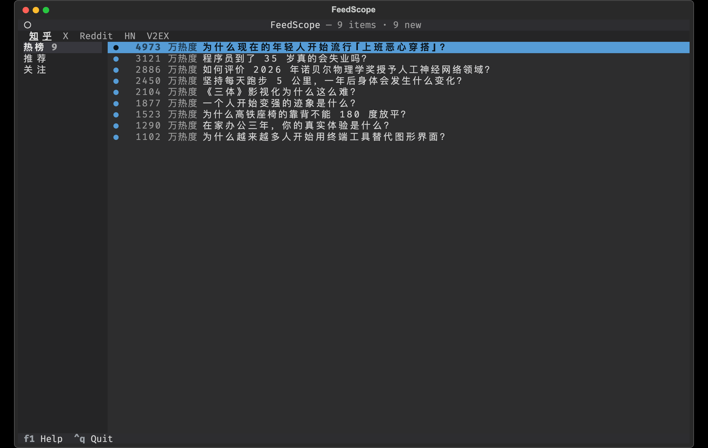

## 快速上手

要求：Python 3.11+、本机已装 Google Chrome；支持 macOS 与 Linux（Windows 暂不支持）。

```bash
pipx install feedscope   # 或：uv tool install feedscope
feedscope                # Tab 切站点，Enter 进详情
```

装完跑 `feedscope doctor` 自检环境。源码安装与镜像配置见[安装](#安装)。

## 为什么选 FeedScope？

- **登录墙源走你自己的浏览器**——知乎、X、Reddit 的取数由常驻页签的真 Chrome 发出：TLS、头序、cookie 与登录会话完全一致，非浏览器画像的封锁根本不适用。与常见终端 RSS 阅读器不同，FeedScope 读的是你真正在刷的那些站——零 API key、零抓取代理
- **扛得住站点改版**——X 轮换的 GraphQL queryId 失效时自动从当前部署重收割；Reddit 版本头 403 自愈；`feedscope probe` 一条命令定位任何断点
- **纯本地**——已读、收藏、列表缓存都在本机明文文件里；无账号、无遥测；`feedscope favorites export` 随时把收藏带走（无锁定）
- **读态不丢**——未读圆点扛过刷新与重启；重启先画缓存秒开列表，断网照样可翻（RSS / Telegram 正文也离线可读）
- **工程质量打底**——631 个离线测试、全量 mypy strict、中英双语、IME 友好的非打印键位；新主题/新语言都是一个 TOML 文件，放进去即被自动发现

## 特性

**信息源**

- 多源聚合：知乎热榜 / 推荐 / 关注，X 推荐 / 正在关注，Reddit 首页 / 热门 / 自选 subreddit，HN 首页 / 最新 / Ask / Show，V2EX 热门 / 最新，Telegram 频道订阅——一个界面，`Tab` 切换
- RSS / Atom 订阅：「全部」流按发布时间合并（跨订阅去重、单源失败不拖垮），feed 自带全文终端内读，条件请求刷新对源友好
- 源按需启用：首启勾选，`F2` 随时增删；站点顺序 = 勾选顺序

**阅读**

- 终端内完整阅读：信息流 → 问题 → 回答 → 评论，逐层按需加载
- 正文链接键盘跟进：`Ctrl+G` 列出正在读的内容里的链接（`[图片]`、`@提及`、原文……），↑↓ 选、Enter 在浏览器打开，不用碰鼠标
- 本地搜索：`F6` 输入即搜，范围是全部列表缓存与收藏（标题对所有源生效，RSS / Telegram 连正文），零请求
- 读到哪都能清未读：`]` / `[` / `Ctrl+R` 在详情屏里同样可用（跳到下一篇未读、把当前这篇标回未读），收藏列表上也有
- 续读位置：重启回到上次的源、流和选中的那条——按条目 id 定位，中间新来的条目把它往下顶也不受影响（它已滚出列表则回第一条）。退出时保存，打开条目时也会顺手记一次
- 已读与未读：行首 `●` 标未读、打开即灭（`Ctrl+R` 可改回），刷新/重启都不动它；「N 新」计数在顶部状态行；列表缓存本地——重启秒开、断网可翻（RSS / Telegram 详情离线可读）
- 收藏/稍后读：`Ctrl+F` 收藏（列表或阅读中都行），`F3` 看跨源收藏列表；存全量快照——条目从热榜流走之后仍可读；在阅读屏里收藏时连已读到的详情一起存，原帖被删 / 之后打不开时就显示这份存档，而不是一条死链。`feedscope favorites export` 随时带走（防锁定）
- HN 讨论树：顶层评论当楼层、回复树再深一层（`Enter`），深层嵌套拍平两层、`@父作者` 标出回复指向
- X 特色：外文推自动附 Grok 译文，`[图片]` / `[视频]` 记号可点击直达原图 / 视频直链
- 登录闭环：未登录自动弹 Chrome 扫码 / 输密码，`Ctrl+U` 一键登出换账号

**终端原生**

- 中英双语：首启选语言（跟随系统预选），`Ctrl+L` 随时改（重启生效）；文案按语言分文件维护
- 编辑器风双主题：深色（VS Code Dark+ 取向，默认）与浅色（Light+ 取向），`Ctrl+T` 实时切换；已读条目标题置灰，扫读一眼分层；`Ctrl+Y` 任意层复制条目链接
- 键位输入法友好：主键位均为非打印键（Tab / 方向键 / 功能键），中文状态照常可用；少量列表动作用 ASCII 符号键（`]` `[` `/` `,` `.`）
- 改版自检：解析出 0 条立即报「站点可能已改版」，`feedscope probe` 一条命令巡检定位

## 界面一览

知乎热榜（左侧信息流边栏，元信息列右对齐自适应）：

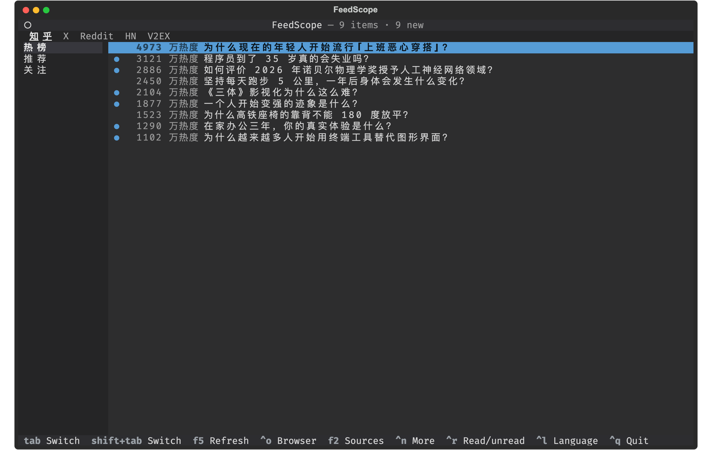

X 推荐时间线（署名「名字 @handle」完整可见，媒体记号可点击直达原图）：

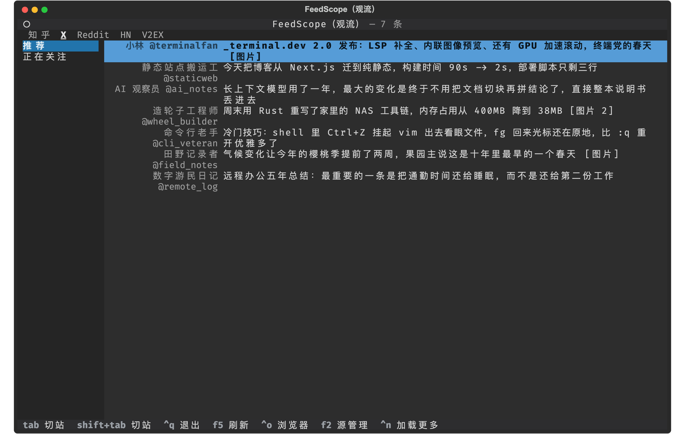

X 推文详情（媒体直链、译文块、引用块）：

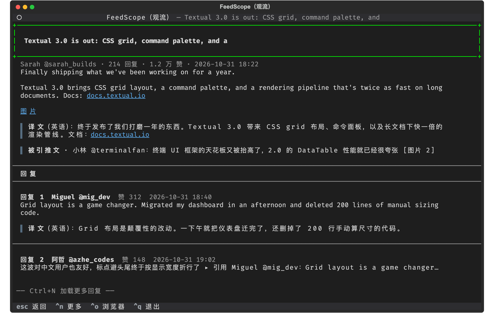

Reddit 热门（元信息列「N 点 · N 评 · r/版块」，subreddit 订阅在 F2 里加）：

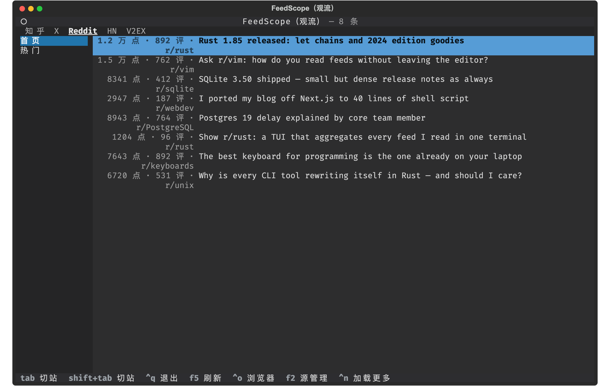

Reddit 帖子详情（markdown 自述正文 + 评论楼层带赞数）：

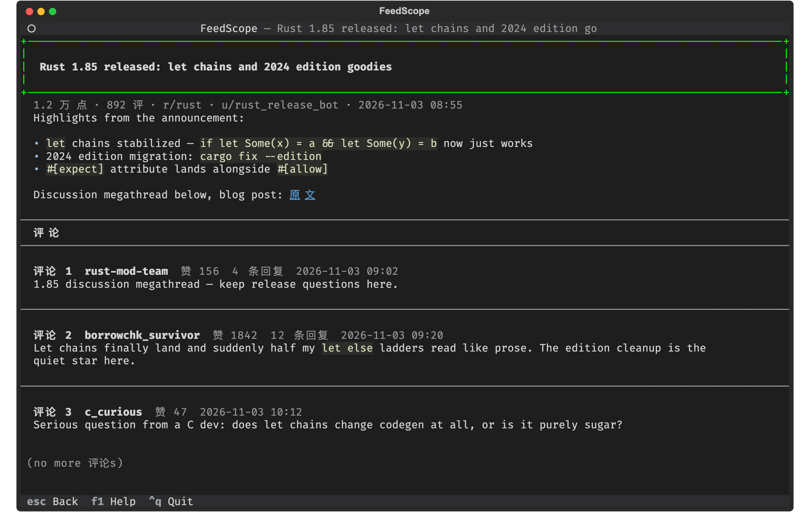

HN 首页（免登录即用，「N 点 · N 评 · 作者」就是讨论热度雷达）：

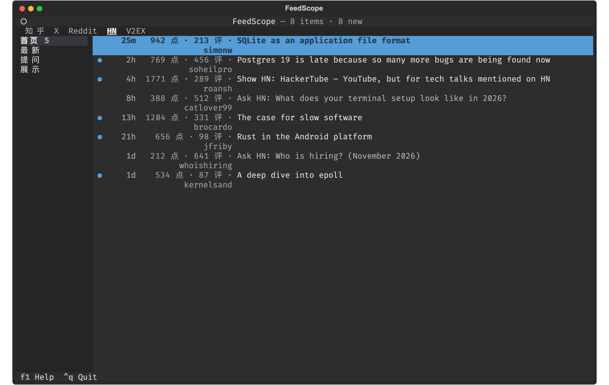

HN story 详情（原文一行 + 顶层评论当楼层，楼层头带「N 条回复」引导）：

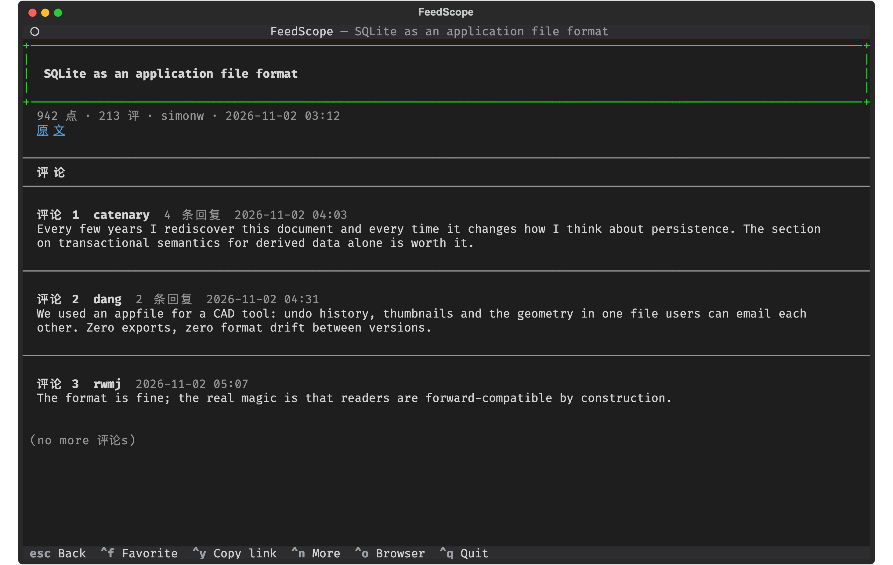

HN 评论的回复树（深层讨论拍平成两层，隔层回复带 `@父作者` 前缀保住对话指向）：

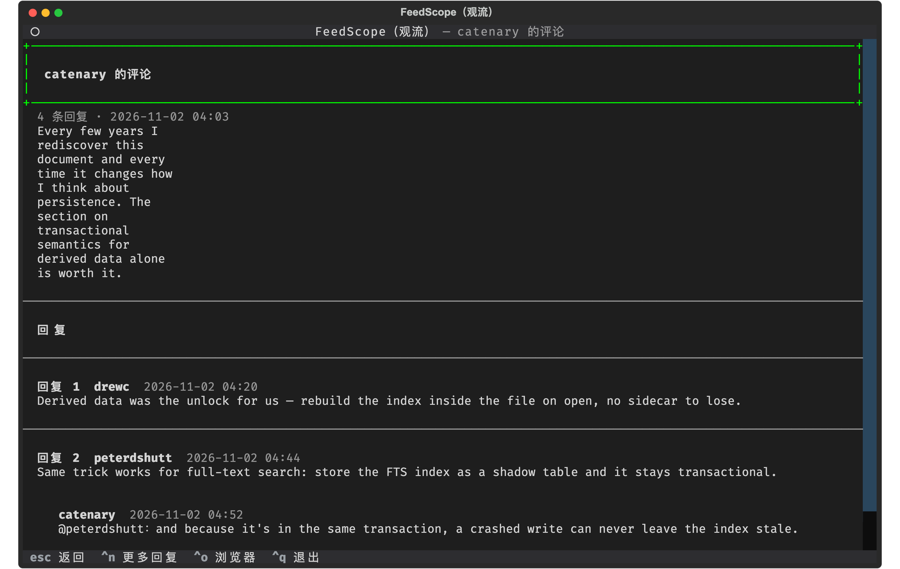

V2EX 热门（免登录，元信息列「节点 · N 回复 · 用户名」扫一眼就是板块和热度）：

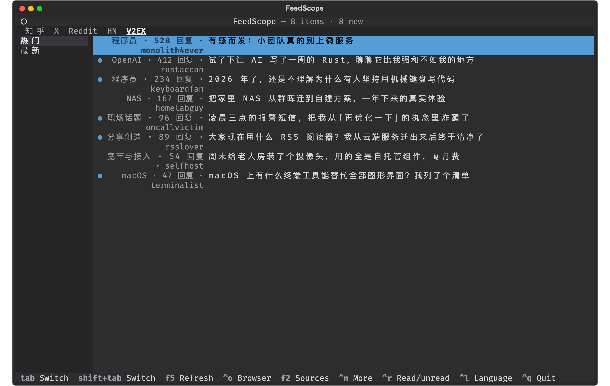

V2EX 主题详情（markdown 正文 + 回复平铺当楼层，楼层号对齐站内楼层文化）：

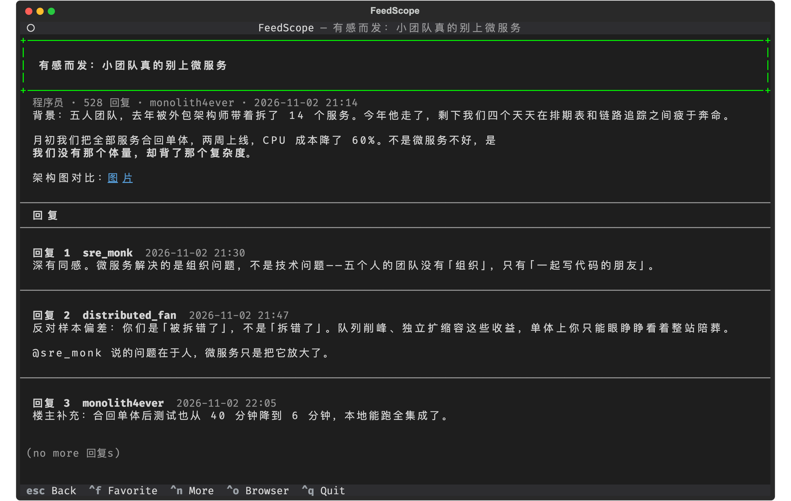

## 安装

要求：Python 3.11+、本机已装 Google Chrome（无需 `playwright install`）。支持 macOS 与 Linux；Windows 暂不支持。

```bash
pipx install feedscope        # 或：uv tool install feedscope
```

从源码安装（开发）：

```bash
git clone https://github.com/howardli/FeedScope.git
cd FeedScope
uv sync                            # 开发 / 测试环境
uv tool install --editable .       # 全局 feedscope 命令：任意目录可启动，改代码即生效
```

- 装完跑 `feedscope doctor` 自检环境
- PyPI 慢可配镜像：`export UV_DEFAULT_INDEX=https://pypi.tuna.tsinghua.edu.cn/simple`
- 开发 / 测试：`uv run feedscope`、`uv run pytest`——详见 [CONTRIBUTING](CONTRIBUTING.md)

## 使用

```bash
feedscope
```

### 键盘快捷键

| 按键 | 功能 |
| --- | --- |
| `Tab` / `Shift+Tab` | 切换站点（切后键盘先落在左侧边栏挑流，`Enter` 回列表；焦点已在源栏时，`Tab` 原地连切） |
| `←` / `→` | 区域移动：列表 `←` 进边栏（停当前流）、`→` 抵右缘；边栏 `→` 回列表、`←` 去源栏；源栏就地切站；详情换上 / 下一篇；回复层换楼层 |
| `↑` / `↓` | 移动选中项 / 滚动正文；任何区域的首行再 `↑` 都上探顶部源栏 |
| `Home` / `End` / `PgUp` / `PgDn` | 滚动列表视口（仅列表态生效） |
| `Enter` | 进详情；详情屏内进「正在阅读」的那个楼层（回答 / 评论）的讨论层；边栏 / 源栏聚焦时回列表 |
| `Ctrl+N` | 加载更多（列表 / 楼层 / 评论，逐层各自生效） |
| `Ctrl+O` | 浏览器打开当前条目 |
| `Ctrl+Y` | 复制当前条目链接（详情/回答层复制的是正在读的那篇，回答层带楼层直达） |
| `Ctrl+G` | 打开正文里的链接：列出正在读的内容里的链接（`[图片]`、`@提及`、原文），↑↓ 选择、Enter 在浏览器打开 |
| `Ctrl+R` | 当前条目已读 / 未读切换（想重看的标回未读；详情屏与收藏列表上同样可用） |
| `F4` | 只看未读：列表只显示未读条目（会话级开关，读过的行即时消失） |
| `]` / `[` | 跳到下一条 / 上一条未读（当前流内环扫回绕；详情屏里直接换到下一篇未读，收藏列表与搜索结果上同样可用） |
| `/` | 按标题过滤列表（大小写不敏感子串；空输入清除；收藏列表同款） |
| `Ctrl+A` | 当前信息流全部标为已读（带确认） |
| `Ctrl+F` | 收藏 / 取消收藏当前条目（阅读中也生效） |
| `F3` | 收藏列表：跨源按收藏时间倒序，Enter 进详情，Ctrl+F 取消 |
| `F5` | 刷新 |
| `F6` | 本地搜索：输入即搜全部列表缓存与收藏（标题对所有源生效，RSS / Telegram 连正文）；↑↓ 选择、Enter 打开、Esc 返回 |
| `Ctrl+U` | 账号：登录 / 登出 |
| `Ctrl+L` | 界面语言：选择后保存，重启 `feedscope` 生效 |
| `Ctrl+T` | 界面主题：选择后即时生效并保存（无需重启） |
| `F2` | 源管理：`Space` / `Enter` 勾选启用 / 停用，保存即生效；`→` 进订阅管理（RSS / Reddit / Telegram） |
| `Esc` | 逐层返回（边栏 / 源栏聚焦时先回列表） |
| `F1` | 键位帮助：全局 + 当前屏的完整键位表（页脚只亮 `F1`/`Esc`，其余键都在这里；`Enter` / `F1` 关闭） |
| `Ctrl+Q` | 退出（`Ctrl+C` 只弹提示指向 `Ctrl+Q`，本身不退出） |

键位以非打印键为主，输入法中文状态照常可用（少量 ASCII 符号键动作：`]` `[` `/` `,` `.`）；误把中文打进来（输入法漏字）会弹提示。顶部 tab 条与左侧边栏可点击，与键盘走同一条路径。

方向键按 CLI 惯例处理：

- `↑`/`↓` 在当前列表里移动选中；任何区域的首行再 `↑` 都上探源栏（顶部区域在所有内容之上），源栏 `↓` 下探边栏（与边栏首流 `↑` 互逆）
- 其余区域移动走横向：列表里 `←` 进边栏（停当前流）、`→` 抵右缘；边栏里 `↑`/`↓` 就地切流、`→` 回列表、`←` 去源栏；源栏里 `←`/`→` 就地切站
- `Enter` / `Esc` 随时回列表
- 弹层（源管理 / 订阅管理 / 输入 / 确认 / 账号）里方向键同样移动焦点：列表到底再 `↓` 进按钮行、`↑` 返回列表、`←`/`→` 在按钮间平移、`Enter` 按下聚焦的按钮

### 已读与离线

行首圆点标记阅读状态：`●` 未读（编辑器蓝）、空白 = 已读。未读是持久状态——刷新、切流、重启都不会动它，圆点只随「打开」消失（`Enter` 进详情、`Ctrl+O` 开浏览器、详情屏 `←`/`→` 换篇都算）；`Ctrl+R` 手动切换当前条目，想重看的标回未读。本次刷新首见几条会计数在顶部状态行（「N 条 · M 新」），不做行级标记。

消化未读的三件套：左侧边栏每个流带**未读角标**（抓取时清点、读一条减一条，在收藏屏里读也同步减主场的数）；`F4` **只看未读**（会话级开关，读过的行即时从视图消失——清积压的主路径）；`Ctrl+A` **当前流全部标已读**（带轻确认）。

收藏（`Ctrl+F`）存的是**收藏那一刻的全量快照**（标题/链接/元信息，RSS / Telegram 连正文一起）——条目从热榜流走、回答被删之后收藏仍可读。在阅读屏里收藏时还会存下**已读到的详情**（正文、回答与回复树）：原帖之后打不开——被删、离线、源已下架——Enter 就显示这份存档并注明，而不是一条死路。`F3` 列表读快照零请求、离线可用，Enter 先按原源在线抓最新内容，抓不到再退回存档。收藏条目豁免已读状态的淘汰；`feedscope favorites` 终端看列表、`feedscope favorites export [x.md]` 导出 Markdown 随时带走。

状态与缓存都是本机纯文本文件（删掉即重置，不含任何凭据）：

| 文件 | 内容 |
| --- | --- |
| `state.json`（状态目录，Linux 为 `~/.local/state/feedscope/`） | 已读/已见/收藏条目 id、时间戳与每流未读计数（上限一万条按最旧淘汰；收藏条目豁免），以及上次的续读位置（源 / 流 / 选中条目） |
| `favorites.json`（同状态目录） | 收藏条目的全量快照（用户数据，永不淘汰），以及在阅读屏收藏时存下的详情 |
| `feedscope.lock`（同状态目录） | 空的锁文件：让同一份状态上的第二个 `feedscope` 提醒两边会互相覆盖已读标记（不挡使用） |
| `feeds/`（缓存目录，Linux 为 `~/.cache/feedscope/feeds/`） | 每流一个 JSON 的列表缓存（每流 200 条、留最近 60 流） |

启动或刷新先画缓存再抓新数据：重启秒开列表；断网或站点改版时旧内容保留可翻，RSS / Telegram 的详情正文随列表缓存离线可读。`feedscope doctor` 会列出状态文件位置。`state.json` / `favorites.json` 读不出来（截断、手编坏了）时不会被直接覆盖，而是先改名为 `<文件名>.corrupt-<时间戳>` 留底，应用按空态继续；`feedscope doctor` 会列出这些留底文件，方便手工找回。

### 界面语言

首启先弹语言选择（预选跟随系统语言，`Enter` 确认、`Esc` 沿用默认），之后 `Ctrl+L` 随时修改；修改保存到配置后**重启 `feedscope` 生效**（数字/单位等文案在抓取时就随语言烙进数据，语言随进程固定是最稳的模型）。**未配置语言时默认英文**——中文用户首启直接回车选简体中文，或 `Ctrl+L` 随时切换。子命令（`doctor` / `probe` / `rss` / `login` / `favorites` / `cache`）的输出与 TUI 同语言：

```toml
language = "zh-CN"   # 或 "en"（缺省）；删掉这行 = 回到默认英文（只有全新安装会重新弹选）
```

新增一种语言：复制 `src/feedscope/core/i18n/en.toml` 为 `<语言码>.toml`（如 `ja.toml`），改 `[meta]` 里的自称（`name = "日本語"`）并翻译文案——语言选择屏自动发现它，零代码改动。各语言目录的键树由测试强制一致（`tests/test_i18n.py`），漏译会红；`src` 里硬编码文案（中英文都算）同样被测试拦下（`tests/test_i18n_no_hardcoded.py`）。

### 界面主题

`Ctrl+T` 随时切换——**即时生效并落盘**（与语言的「重启生效」不同：主题是纯显示层）。内置 `editor-dark`（默认）与 `editor-light`；配置里手动指定 `theme = "editor-light"`，删掉该行 = 回默认深色。新增一个主题：复制 `src/feedscope/ui/themes/editor-dark.toml` 改色即被自动发现（零代码），色槽完整性由 `tests/test_theme.py` 钉住。

### 展示时区

时间戳（列表行的相对时间列、详情页的时间行）默认按**北京时间（UTC+8）**展示——刻意不跟本机时区，同一份内容在服务器上和海外笔记本上读起来一致。配置里写 IANA 名即可更换：

```toml
timezone = "Asia/Tokyo"   # 任意 IANA 时区名；删掉该行 / 写错 = 回默认 UTC+8
```

与语言一样随进程固定（已格式化的时间会进列表缓存；时间列背后的 `published` 原始时间戳始终跟随当前设置）。列表没有时间可取的源（知乎热榜/推荐）不会出现该列。

### 登录 / 登出

知乎、X 与 Reddit 需要登录（无匿名流）；HN、V2EX、RSS 与 Telegram 免登录开箱即用。未登录打开源会自动弹登录框，选「登录」弹 Chrome 完成后自动刷新，不用退出 TUI；取消后本次运行不再追问（`Ctrl+U` 仍可手动登录）。已登录按 `Ctrl+U` 登出换账号。纯命令行：`feedscope login [zhihu|x|reddit]`。登录会话存在本机 Chrome profile（Linux 为 `~/.cache/feedscope/chromium-profile/`）——详见 [SECURITY](SECURITY.md)。登录窗口开着期间 HN / V2EX / RSS / Telegram 照常可用，知乎 / X / Reddit 暂停到窗口关闭。

登录态被服务端吊销（改密码、异地登出、定期轮换）不会让你对着 403 猜：X 的 401 语义唯一（清失效 cookie 后引导重登）；知乎会话半失效时列表照常、详情端点回 403（实测形态），同样在详情/回答/评论层转成登录引导而不是裸 HTTP 码，且失效一旦被记下 Ctrl+U 就直接给登录框（躺着的失效 cookie 会骗过判登，否则得先登出再登录）；知乎、Reddit 与 X 的取数都走常驻浏览器页签的真 Chrome（TLS/头序/cookie 与登录会话完全自洽，不吃非浏览器画像的封锁）。Reddit 的判据是 token_v2 的 JWT 本地解码（登录态 `sub="user"`、匿名态 `sub="loid"`）——它的判登 cookie 匿名流量也发（打开登录页即有，cookie 出现 ≠ 登录完成），而本地解码零网络零伪造，「登录成功」和判登门都以此为准，反复要求登录的循环在结构上不可能。

### 站点一览

| 站点 | 信息流 | 需登录 |
| --- | --- | --- |
| 知乎 | 热榜 / 推荐 / 关注 | ✅ |
| X（Twitter） | 推荐 / 正在关注 | ✅ |
| Reddit | 首页 / 热门 / 自选 subreddit | ✅ |
| HN | 首页 / 最新 / Ask / Show | — |
| V2EX | 热门 / 最新 | — |
| RSS | 全部 / 每订阅一流 | — |
| Telegram | 全部 / 每频道一流 | — |

### 子命令

```bash
feedscope [tui]           # 启动 TUI（默认）
feedscope login [源 id]   # 弹浏览器登录（默认 zhihu，如 x、reddit）
feedscope probe [源 id…]  # 全源巡检：定位改版，原始样本落盘
feedscope doctor          # 环境自检（Chrome / profile / 配置 / 状态 / 日志）
feedscope cache [clear]   # 列表缓存体检 / 清空（纯派生数据，无损）
feedscope rss add <url> [--key k --label 名]  # 加订阅：feed 直链 / 站点首页（自动发现）/ OPML 路径
feedscope rss list | remove <key>             # 查看 / 删除订阅
feedscope rss rename <key> <名>               # 改订阅显示名
feedscope rss import <x.opml> | export [x.opml]  # OPML 批量迁入（幂等合并）/ 导出
feedscope favorites [export [x.md]]           # 收藏列表 / 导出 Markdown（防锁定）
```

全局旗标：`--verbose`（日志提到 DEBUG，子命令同时镜像 stderr）、`--log-file <路径>`（换日志位置）与 `--version`。`rss export` / `favorites export` 不带文件参数时输出到 stdout（方便重定向）。

环境变量：`FEEDSCOPE_NO_PREWARM=1` 启动不预拉浏览器（慢机器友好）；`FEEDSCOPE_SAMPLE_DIR=<目录>` 让普通运行也把原始响应落盘（与 `probe` 同款样本）；`FEEDSCOPE_CONFIG` / `FEEDSCOPE_LOG_FILE` 换配置 / 日志位置。

退出码约定（方便脚本分支）：`probe` 巡检有失败退 1、未知源 id 退 2；`rss add` / `rss import` 坏 OPML 退 2，`add` 订阅冲突另退 1；`doctor` 自检有失败退 1——没装 Chrome、`sources.toml` 解析不了，或有不生效的设置（`enabled` 里有不存在的源 id、`hide` 里的名字对不上任何流、未知的 `language` / `timezone`、缺 url 的订阅条目……），每条问题各占一行。

### 故障排查与日志

每次运行都会写日志文件（INFO 级），位置见 `feedscope doctor` 的信息行——macOS 是 `~/Library/Logs/feedscope/feedscope.log`，Linux 在 `~/.local/state/feedscope/log/feedscope.log`，1MB 滚动 ×3。出问题时答案多半已经在里面：带异常栈的抓取失败、自愈路径（X queryId 重收割、Reddit 版本头）悄悄回落的过程、登录判据的报错。`--verbose` 提到 DEBUG 看细节；`FEEDSCOPE_LOG_FILE` 永久换位置。TUI 里任何日志都不走 stderr（会打花重绘流），文件是唯一去处。

同一份数据上开两个 `feedscope`：浏览器 profile 是受保护的——发现 profile 锁属于一个活着的进程时，不会启动 Chrome 并报出该进程的 pid；状态文件不加锁，同一份状态上的第二个 TUI 实例会提醒已读与收藏会互相覆盖。

### 源与信息流配置

首次启动先弹勾选引导；之后 `F2` 随时增删。勾选落盘到用户配置（Linux 为 `~/.config/feedscope/sources.toml`，`FEEDSCOPE_CONFIG` 可换路径），也可手动编辑，改完重启生效：

```toml
language = "zh-CN"  # 界面语言（首启 / Ctrl+L 维护）
browser = "open -a Firefox"   # 可选：打开链接的命令（%u 换成链接）；缺省走系统默认浏览器
clipboard = "pbcopy"          # 可选：从 stdin 读文本的复制命令；缺省自动探测，都没有再退终端的 OSC 52
enabled = ["zhihu", "x", "reddit", "hn", "v2ex", "rss"]  # 书写顺序即站点排列顺序；去掉某项 = 停用该源

[zhihu]
hide = ["follow"]    # 隐藏不想看的内置流

[reddit.feeds]       # subreddit 订阅表：key 即流名（r/home、r/popular 与内置流撞名的拒收）
rust = { label = "Rust", url = "https://www.reddit.com/r/rust/" }

[telegram.feeds]     # 频道订阅表：key 即流名（避免与聚合流名 all 撞名）
durov = { url = "https://t.me/durov/" }

[rss.feeds]          # RSS 订阅表：key 即流名（避免与保留字 all 撞名）
ruanyq = { label = "阮一峰周刊", url = "https://www.ruanyifeng.com/blog/atom.xml" }
hnrss = { url = "https://hnrss.org/newest?q=rust" }   # label 缺省用 key（关键字订阅仍可走 hnrss，HN 本站用内置源）

[rss]
hide = ["all"]       # 可隐藏「全部」聚合流，或填订阅 key 隐藏单个订阅
```

`enabled` 缺省 = 全部启用；管理界面保存会保留各源 `hide` 段与 `feeds` 订阅表（`[rss.feeds]` / `[reddit.feeds]` / `[telegram.feeds]`）——0.4.0 起手写的注释与未知键也原样保留（tomlkit 往返）。调整站点顺序：`F2` 里高亮已勾选的源按 `,` / `.` 微调（「取消勾选再重新勾选」仍是移到末尾）。SSH / 无桌面环境下缺省值够不着浏览器和剪贴板，`browser` / `clipboard` 就派上用场：配成那边能用的命令（如 `clipboard = "tmux load-buffer -"`），或者用 `Ctrl+Y` 复制链接。不会生效的设置 `feedscope doctor` 会报出来。

### RSS 订阅

订阅管理三条路，任选：

- **TUI 内（F2）**：`F2` 源管理里光标移到 RSS 行按 `→` 进订阅管理屏——`Insert` 添加、`Enter` 改名、`Delete` 删除、`↑↓` 选择，改动即时落盘；返回后 RSS 自动勾上，保存即生效
- **子命令**：`feedscope rss add / list / remove` 增删查；从别的阅读器迁移用 `feedscope rss import 订阅.opml`（Feedly / Inoreader / NetNewsWire 等导出的 OPML 都认，已订阅的自动跳过）；`export` 随时可带走订阅防锁定
- **手编配置**：直接改 `[rss.feeds]` 表（见上节示例），加完 `F2` 勾选 RSS 启用

添加入口的便利设计（TUI 添加框与 `rss add` 行为一致）：

- 地址粘 RSS/Atom 直链，**或直接粘站点首页**——自动发现页面上声明的 feed
- 粘**本地 OPML 文件路径** = 批量导入（从 Finder 把文件拖进终端即得路径）
- 显示名缺省拉一次 feed 标题；add / import 会自动把 RSS 加进启用列表，不用再开 F2

零订阅时 RSS 不出现在源列表（F2 里仍可选中它进订阅管理添加第一条）。行为要点：

- 「全部」流 = 全部订阅按发布时间倒序合并，同文多源（转载 / 聚合）按 URL 去重；单个订阅拉取失败只损失自己的条目，全部失败才报错
- 详情读 feed 自带正文（`content` 全文优先，`summary` 兜底），图片转原图直链；摘要型源正文短，`Ctrl+O` 跳浏览器读全文
- 刷新走条件请求（ETag / Last-Modified），源没变不重复传正文
- 也认 JSON Feed（自动发现本就接纳 `feed+json`）；正文里的相对链接与图片地址按条目自己的页面补全，enclosure（播客、视频源）在正文后以 `[音频]` / `[视频]` / `[附件]` 链接出现
- RSS 无登录、无评论层

### Hacker News

免登录免 key，数据走 [Algolia 公开索引 API](https://hn.algolia.com/api)（HN 官网站内搜索同源）。行为要点：

- 三层结构与知乎同形：story（链接帖正文 = 原文一行，Ask/Show 带自述全文）→ 顶层评论当楼层（Enter 进单条评论的回复树）
- 元信息列「N 点 · N 评 · 作者」；深层嵌套讨论拍平成两层，隔层回复带 `@父作者` 前缀保住对话指向
- 索引有分钟级延迟，列表按热度排序（非官方榜序）；无回复的楼层不预告 Enter

### V2EX

免登录，数据走官方 v1 公开端点（hot / latest / replies，无需 token；[官方 API 参考](https://www.v2ex.com/help/api)）。行为要点：

- 两层结构：主题（markdown 正文，自动内联图片换 `[图片]` 记号、`@` 提及转可点击链接）→ 回复平铺当楼层；V2EX 回复没有嵌套结构（「楼中楼」只是正文里的 `@` 文字），故无第三层
- 元信息列「节点 · N 回复 · 用户名」；楼层号对齐站内楼层文化，楼层直达链接是原帖页的 `#reply` 锚点
- 官方接口一次给全量（列表一页、回复不分页），楼层翻页零请求；正文随列表透传，打开一篇详情只花 1 个请求

### X（Twitter）

需要登录，数据走网页端 GraphQL——请求由常驻浏览器页签的真 Chrome 发出（与知乎 / Reddit 同款通道：TLS、头序、cookie 与登录会话完全自洽，cf_clearance 之类的指纹封锁对页内 fetch 天然不存在）。接口的 queryId 随 X 部署轮换，本源以快照常量起步、**失效自动收割自愈**：报错时重开页签收集当前部署的 JS chunk、grep 出新 queryId 原参重试——X 改版从「跑脚本手抄常量」变成「当天自动恢复」。行为要点：

- 元信息列「名字 @handle」；外文推自动附 Grok 译文块，媒体换 `[图片]` / `[视频]` 记号可点击直达原图 / 视频直链
- 详情：焦点推全文 + 引用链展开，回复沿 ShowMore 游标翻页；转发（RT）自动跳到原推的会话
- 搜索不做：SearchTimeline 的 transaction-id 门禁只有 X 自己的 JS 会算头，页内 fetch 同样进不去

### Reddit

需要登录，数据走**网站自己的 HTML 通道**——`.json` 遗留端点 2026 年起对第三方全线 403，本源改吃新版前端自己用的路：列表页 SSR HTML 起步、翻页跟 `faceplate-partial` 的 load-after 链。请求由常驻浏览器页签的真 Chrome 发出（与知乎同款通道：TLS、头序、cookie 与登录会话完全自洽，不吃非浏览器画像的封锁）；`x-reddit-client-version` 从页面响应自动收割（403 时重割自愈）。行为要点：

- 三层结构与 HN 同形：帖子（自述帖 HTML 转 markdown、链接帖原文一行、媒体帖 `[图片]` / `[视频]` 记号直达原图）→ 顶层评论当楼层（`Enter` 进单条评论的回复树）
- 登录判据：token_v2 的 JWT 本地解码（登录态 `sub="user"`、匿名态 `sub="loid"`）——reddit_session 和 token_v2 的「存在」匿名流量也能造出来，解码才是铁证；登录轮询与判登门共用这一条，零网络零伪造
- 元信息列「N 点 · N 评 · r/版块」；楼层带赞数；深层讨论拍平两层、`@父作者` 标出指向（同 HN）
- 「首页」是账号在 Reddit 站内关注版块的聚合（新账号没关注过版块时为空，属正常）；想看的版块用订阅：`F2` → Reddit 行按 `→`，输入 subreddit 名或地址（`rust`、`r/rust`、站点链接都认）即成单独的流，不必去 Reddit 网站关注
- 评论树单请求拉全（超大帖截断），截断处显示「另有 N 条未展开」；楼层 / 评论翻页全内存切片零请求

### Telegram 频道

免登录，数据走频道公开 Web 预览页（`t.me/s/<频道>`，服务端渲染 HTML，站长开启预览即可读）。行为要点：

- 与 RSS 同形的纯订阅源：`F2` → Telegram 行按 `→` 进订阅管理，输入频道名或链接（`durov`、`@durov`、`t.me/durov`、帖子直链都认），显示名缺省拉频道名
- 「全部」流 = 全部频道按发布时间倒序合并，单频道失败只损失自己的条目；每频道也各自成流（可 `hide` 单藏）
- 元信息列「N 观看」是频道帖的热度雷达；「全部」流里每行带源名列标频道名（与收藏列表同款，出处成列不挤元信息）；正文行内 HTML 转 markdown、图片/视频换 `[图片]` / `[视频]` 记号（视频无直链，记号指向帖子页）
- 详情读列表自带正文（零请求）；单频道流 `Ctrl+N` 走 `?before=` 游标往回翻历史帖；无评论层（频道讨论组在预览页拿不到）

## 路线图

- Windows 支持（当前为 macOS 与 Linux）
- 更多源——欢迎到 [discussions](https://github.com/howardli/FeedScope/discussions) 提案；新增一个源被设计成只动一个包的活

未排期；0.x 的优先级跟着用户反馈走。

## 社区

- **Bug 与功能**——[issues](https://github.com/howardli/FeedScope/issues)：bug 模板会请你贴 `feedscope doctor` 输出，几行带上版本与环境，省一个来回
- **提问与交流**——[discussions](https://github.com/howardli/FeedScope/discussions)
- **参与开发**——[CONTRIBUTING](CONTRIBUTING.md)：新增一个源被设计成只动一个包的活，新增一种界面语言只需一个 TOML 文件
- **安全**——[SECURITY.md](SECURITY.md)：登录 cookie 存在哪里、漏洞如何私密上报
- **更新日志**——[CHANGELOG.md](CHANGELOG.md)

状态：**0.x，活跃开发中**。配置格式在小版本间只增不破，破坏性变更等 1.0；站点改版随时可能弄断对应源——`feedscope probe` 定位，补丁版本跟进新解析器。

## 免责声明

本项目通过本机浏览器会话访问知乎、X 与 Reddit 的网页接口，仅供个人学习与研究：

- 请遵守所在地区法律法规及各站用户协议，账号风控风险自担
- 不带任何内置凭据，登录态只存于本机浏览器 profile，不与第三方共享
- 站点改版导致失效属正常损耗（`feedscope probe` 可巡检定位）；请勿用于批量抓取或商业用途

## 许可证

[MIT](LICENSE)
